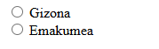
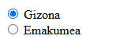
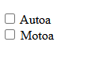
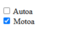
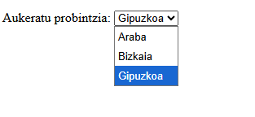
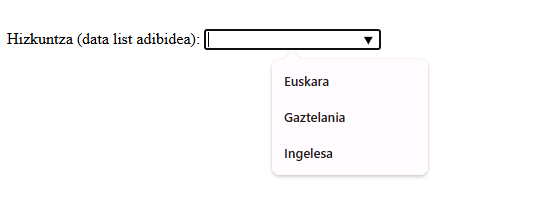

# Formularios

Los formularios se utilizan para recoger datos del usuario. Por ejemplo, se pueden usar para introducir el nombre, iniciar sesión, escribir un mensaje o responder a una encuesta.

Dentro de un formulario puede haber varios controles: campos de texto, botones de opción, casillas de verificación, listas y botones.

---

## Etiqueta `<form>`

La etiqueta `<form>` agrupa los controles de un formulario.

```html
<form>
    <!-- Controles del formulario -->
</form>
```

Cuando un formulario debe enviarse a un servidor, se utilizan estos dos atributos:

| Atributo | Descripción |
|----------|-------------|
| `action` | Dirección a la que se enviarán los datos. |
| `method` | Método utilizado para enviar los datos, por ejemplo, `get` o `post`. |

!!! note "En esta lección"
    Los formularios se crearán mediante HTML y se utilizarán en el navegador. Los botones de los ejemplos tendrán `type="button"` y no realizarán ninguna acción de envío de datos.

---

## Etiqueta `<label>`

La etiqueta `<label>` indica qué se debe escribir o seleccionar en un control. El atributo `for` de la etiqueta y el atributo `id` del control deben tener el mismo valor.

```html
<label for="izena">Nombre</label>
<input type="text" id="izena" name="izena">
```

Haz clic en el texto **Nombre**. El cursor se colocará en el campo de texto. También se puede utilizar esta relación en los controles `radio` y `checkbox`: al hacer clic en el texto de la opción, se marca el control.

---

## `id`, `name` y `value`

| Atributo | Para qué se utiliza |
|----------|---------------------|
| `id` | Identifica el control dentro de la página y lo relaciona con su etiqueta. Cada `id` debe ser único en la página. |
| `name` | Da nombre al dato del control. En los botones `radio`, las opciones del mismo grupo tienen el mismo `name`. |
| `value` | Establece el valor inicial de un campo de texto o indica el valor correspondiente a una opción. |

```html
<label for="parte-hartzailea">Nombre</label>
<input type="text" id="parte-hartzailea" name="izena" value="Jon">
```

En el ejemplo, `parte-hartzailea` es el identificador que utiliza la etiqueta para encontrar el control. `izena` es el nombre del dato y `Jon` es el valor que aparece inicialmente en el campo. Los atributos `id` y `name` del control pueden coincidir, pero cada uno tiene su propia función.

---

## Campo de texto (`text`)

Se utiliza para escribir textos cortos.

```html
<label for="erabiltzailea">Nombre de usuario (obligatorio)</label>
<input
    type="text"
    id="erabiltzailea"
    name="erabiltzailea"
    placeholder="Por ejemplo, jon"
    minlength="3"
    maxlength="20"
    required>
```

| Atributo | Descripción |
|----------|-------------|
| `value` | Valor inicial del campo. |
| `placeholder` | Texto de ayuda que aparece cuando el campo está vacío. |
| `size` | Anchura visual del campo, indicando aproximadamente cuántos caracteres pueden verse. |
| `minlength` | Longitud mínima que debe tener el texto introducido. |
| `maxlength` | Número máximo de caracteres que se pueden introducir. |
| `required` | Indica que el campo debe rellenarse obligatoriamente. |

Utiliza siempre `<label>` para mantener visible el nombre del campo. El atributo `placeholder` puede usarse para mostrar un breve ejemplo.

---

## Contraseña (`password`)

Oculta los caracteres escritos en la pantalla.

```html
<label for="pasahitza">Contraseña</label>
<input type="password" id="pasahitza" name="pasahitza">
```

---

## Dirección electrónica (`email`)

Se utiliza para escribir una dirección electrónica. El navegador comprueba que el texto introducido tenga el formato de una dirección electrónica. Al añadir `required`, también se obliga a rellenar el campo.

```html
<label for="emaila">Dirección electrónica (obligatoria)</label>
<input type="email" id="emaila" name="emaila" required>
```

---

## Otros tipos útiles de `input`

| Tipo | Uso |
|------|-----|
| `number` | Para introducir números. |
| `date` | Para seleccionar una fecha. |
| `color` | Para seleccionar un color. |
| `file` | Para seleccionar un archivo del dispositivo. |
| `range` | Para seleccionar un valor mediante una barra. |

```html
<label for="data">Fecha</label>
<input type="date" id="data" name="data">

<label for="kopurua">Número de participantes</label>
<input type="number" id="kopurua" name="kopurua" min="1" max="10">

<label for="kolorea">Color favorito</label>
<input type="color" id="kolorea" name="kolorea">

<label for="fitxategia">Selecciona un archivo</label>
<input type="file" id="fitxategia" name="fitxategia">

<label for="balorazioa">Valoración</label>
<input type="range" id="balorazioa" name="balorazioa" min="0" max="10">
```

---

## Botones de opción (`radio`)

Se utilizan para seleccionar una única opción dentro de un grupo. Los botones del mismo grupo tienen el mismo `name`. Cada opción tiene su propio `id` y `value`.

El atributo `checked` indica qué opción estará marcada inicialmente.

```html
<fieldset>
    <legend>¿Qué turno prefieres?</legend>

    <input type="radio" id="goiza" name="txanda" value="goiza" checked>
    <label for="goiza">Por la mañana</label>

    <input type="radio" id="arratsaldea" name="txanda" value="arratsaldea">
    <label for="arratsaldea">Por la tarde</label>
</fieldset>
```





---

## Casillas de verificación (`checkbox`)

Cada casilla se puede marcar o desmarcar por separado. En una lista de opciones, el usuario puede no marcar ninguna, marcar una o marcar varias. El atributo `checked` se puede utilizar para marcar una casilla inicialmente.

```html
<fieldset>
    <legend>¿Qué medios de transporte utilizas?</legend>

    <input type="checkbox" id="autoa" name="garraiobidea" value="autoa">
    <label for="autoa">Coche</label>

    <input type="checkbox" id="motoa" name="garraiobidea" value="motoa" checked>
    <label for="motoa">Moto</label>
</fieldset>
```





!!! tip "Probar en el navegador"
    Pulsa el texto **Por la tarde** y observa cómo se desmarca automáticamente la opción de la mañana. Después, marca **Coche** y **Moto**. Las dos casillas pueden marcarse a la vez.

---

## Lista desplegable (`select`)

La etiqueta `<select>` crea una lista de opciones. Cada opción se escribe con la etiqueta `<option>`.

```html
<label for="lurraldea">Territorio</label>
<select id="lurraldea" name="lurraldea">
    <option value="araba">Álava</option>
    <option value="bizkaia">Vizcaya</option>
    <option value="gipuzkoa" selected>Guipúzcoa</option>
</select>
```



| Atributo | Dónde se coloca | Descripción |
|----------|-----------------|-------------|
| `value` | `<option>` | Valor correspondiente a la opción. |
| `selected` | `<option>` | Opción que aparecerá seleccionada inicialmente. |
| `multiple` | `<select>` | Permite seleccionar más de una opción. |
| `required` | `<select>` | Indica que es obligatorio seleccionar una opción. |

Si el usuario debe realizar una selección, coloca inicialmente una opción con `value=""`. De este modo, verá el mensaje inicial antes de abrir la lista.

```html
<label for="jarduera">Actividad (obligatoria)</label>
<select id="jarduera" name="jarduera" required>
    <option value="">Selecciona una actividad</option>
    <option value="argazkilaritza">Fotografía</option>
    <option value="antzerkia">Teatro</option>
</select>
```

Para seleccionar más de una opción:

```html
<label for="hizkuntza-aukerak">Idiomas</label>
<select id="hizkuntza-aukerak" name="hizkuntza" multiple>
    <option value="eu">Euskera</option>
    <option value="es">Castellano</option>
    <option value="en">Inglés</option>
</select>
```

---

## Campo de texto multilínea (`textarea`)

Se utiliza para escribir mensajes, comentarios o notas.

```html
<label for="oharrak">Notas</label>
<textarea
    id="oharrak"
    name="oharrak"
    rows="6"
    cols="40"
    maxlength="200"
    placeholder="Escribe tus notas"></textarea>
```

El atributo `rows` indica el número de líneas que se verán inicialmente y el atributo `cols` indica la anchura aproximada del campo. Si quieres incluir texto inicial, escríbelo entre las etiquetas `<textarea>` y `</textarea>`.

---

## Sugerencias de datos (`datalist`)

Muestra sugerencias mientras el usuario escribe. El atributo `list` del elemento `<input>` y el atributo `id` del elemento `<datalist>` deben tener el mismo valor.

```html
<label for="hizkuntza">Idioma</label>
<input type="text" id="hizkuntza" name="hizkuntza" list="hizkuntzak">

<datalist id="hizkuntzak">
    <option value="Euskera">
    <option value="Castellano">
    <option value="Inglés">
</datalist>
```

El usuario puede seleccionar una sugerencia de la lista o escribir otro valor.



---

## Agrupación de controles (`fieldset` y `legend`)

La etiqueta `<fieldset>` agrupa controles relacionados entre sí. La etiqueta `<legend>` indica el título o la pregunta del grupo.

```html
<fieldset>
    <legend>Datos personales</legend>

    <div>
        <label for="datu-izena">Nombre</label>
        <input type="text" id="datu-izena" name="izena">
    </div>

    <div>
        <label for="abizenak">Apellidos</label>
        <input type="text" id="abizenak" name="abizenak">
    </div>
</fieldset>
```

Cada `<div>` agrupa la etiqueta y el campo. Los espacios entre los grupos se pueden establecer mediante CSS, por ejemplo, utilizando `margin`.

---

## Botones

Escribe siempre el atributo `type` del botón para indicar claramente qué acción debe realizar.

```html
<button type="submit">Enviar</button>
<button type="reset">Restablecer los valores iniciales</button>
<button type="button">Probar</button>
```

| Tipo | Descripción |
|------|-------------|
| `submit` | Intenta enviar el formulario. El navegador comprueba primero las condiciones HTML. |
| `reset` | Devuelve los controles del formulario a su estado inicial. La opción que estaba marcada inicialmente volverá a marcarse. |
| `button` | No realiza ninguna acción por sí solo. Más adelante se le puede asignar una acción mediante JavaScript. |

---

## Validación mediante HTML

Mediante los atributos de HTML se pueden indicar las condiciones que debe cumplir cada campo. El navegador comprueba automáticamente esas condiciones cuando se intenta enviar el formulario. Un botón con `type="button"` no inicia esta comprobación automática.

| Atributo o tipo | Condición |
|-----------------|-----------|
| `required` | Es obligatorio rellenar el campo o seleccionar la opción correspondiente. |
| `type="email"` | El texto introducido debe tener el formato de una dirección electrónica. |
| `min` y `max` | Los valores deben estar dentro de los límites especificados. |
| `minlength` y `maxlength` | El texto debe cumplir la longitud especificada. |

```html
<label for="plazak">Número de plazas (de 1 a 4)</label>
<input type="number" id="plazak" name="plazak" min="1" max="4" required>
```

!!! example "Probar sin enviar"
    Escribe `0`, `2` y `5`, uno después de otro, en el campo del número de plazas. Para ver qué valores considera inválidos el navegador en ese campo, añade temporalmente esta regla CSS:

    ```css
    #plazak:invalid {
        outline: 2px solid crimson;
    }
    ```

    Al escribir `0` y `5`, el borde se resaltará en rojo. Al escribir `2`, el resaltado desaparecerá. Cuando el campo esté vacío también aparecerá en rojo, porque tiene el atributo `required`.
