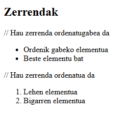
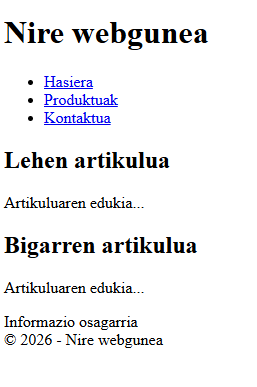
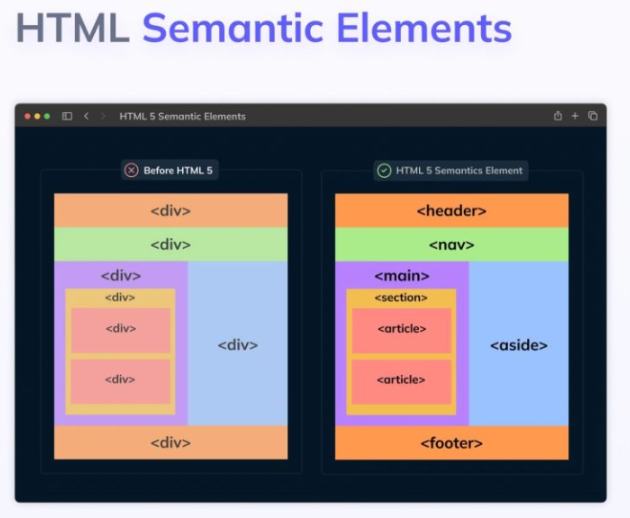
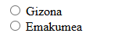
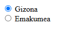
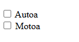
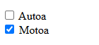
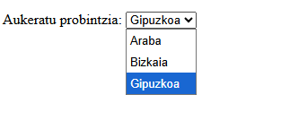
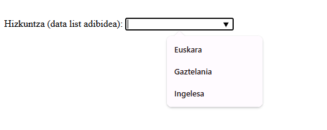
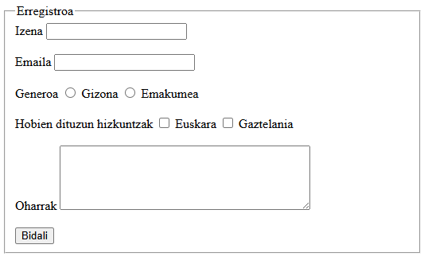

# HTML

HTML5 es la última revisión del estándar HTML y añade nuevas etiquetas semánticas que dan estructura y significado al contenido de la página.

## ¿Qué es HTML?

1. HTML significa **HyperText Markup Language** (lenguaje de marcado de hipertexto).
2. Es el **lenguaje estándar para crear páginas web**.
3. Define la **estructura** de una página web usando "etiquetas".
4. Las **etiquetas HTML** indican cómo deben **mostrarse** los elementos (texto, imágenes, enlaces, etc.).
5. No es un lenguaje de programación, sino un lenguaje de marcado.
6. Funciona junto con **CSS** (para el diseño) y **JavaScript** (para la interactividad).
7. Los archivos HTML tienen la extensión **.html o .htm**.

!!! tip "Editor"
    Se recomienda utilizar **[Visual Studio Code](https://code.visualstudio.com/){: target="_blank" rel="noopener" }** para escribir código.

## Estructura básica de un documento

```html
<!DOCTYPE html>
<html lang="es">
<head>
    <meta charset="UTF-8">
    <title>Mi página</title>
</head>
<body>
    <h1>Hola mundo</h1>
</body>
</html>
```

- `doctype` identifica el estándar HTML que se está utilizando.
- La etiqueta `<html>...</html>` engloba todo el documento.
- `<head>` contiene metadatos; `<body>` contiene el contenido visible.
- `<title>` establece el título de la página (el que aparece en la pestaña del navegador).

Todos los elementos dentro de `<head>` son opcionales, excepto `<title>`:
es el único que debe estar presente necesariamente.

## Atributos

Modifican el comportamiento general de las etiquetas (color, alineación, estilos...). Un atributo se compone del nombre, el símbolo `=`, y el valor que toma, escrito entre comillas:

```html
<elemento_nombre atributo1="valor1" atributo2="valor2">...</elemento_nombre>
```

!!! example "Ejercicio 1"
    Empezaremos a practicar; para ello, realizaremos primero el siguiente ejercicio: [Ejercicio 1](https://docs.google.com/document/d/1bX3VveTiWPALXlwyk2_bzWR_Lmldd4CsQWVppNYj1LA/edit?usp=sharing){: target="_blank" rel="noopener" }

## Metadatos (`<head>`)

- `<meta charset="UTF-8">`: garantiza que los símbolos y acentos se muestren correctamente.
- `<meta name="viewport" content="width=device-width, initial-scale=1">`:
  optimiza la vista en dispositivos móviles.
- `<meta name="description" content="...">`: describe la página (la usan los buscadores).
- `<style>`: permite insertar CSS directamente en el documento.
- `<link rel="icon" sizes="192x192" href="/ruta/icono.png">`: añade un favicon.
- `<base>`: indica la **raíz del sitio web** y permite que todas las rutas relativas de los enlaces (`href`, `src`...) se resuelvan partiendo de esa raíz.

**Control de rastreo del navegador (`robots`):**

```html
<meta name="robots" content="index, follow">
<meta name="robots" content="noindex, follow">
<meta name="robots" content="index, nofollow">
```

- `index, follow`: indexa la página y sigue sus enlaces.
- `noindex, follow`: no la indexa, pero sí sigue sus enlaces.
- `index, nofollow`: la indexa, pero ignora sus enlaces.

**Ejemplo completo de `<head>`:**

```html
<head>
    <title>Mi sitio web</title>
    <base href="https://www.URL.com/" target="_blank">
    <meta charset="UTF-8">
    <meta name="description" content="Hablaré sobre mi sitio web">
    <meta name="keywords" content="HTML, CSS, JavaScript">
    <meta name="author" content="Jone">
    <link rel="stylesheet" type="text/css" href="URL">
</head>
```

## Títulos (`<h1>`-`<h6>`) y línea horizontal

Los encabezados ordenan los títulos `<h1>` a `<h6>` por tamaño de forma estricta, de mayor a menor. Son elementos de bloque.

```html
<body>
    <h1>Título H1</h1><h2>Título H2</h2>
    <h3>Título H3</h3><h4>Título H4</h4>
    <h5>Título H5</h5><h6>Título H6</h6>
</body>
```

La etiqueta `<hr>` crea una línea horizontal para separar párrafos.
Se puede usar junto con `<hgroup>`, para agrupar títulos relacionados:

```html
<body>
    <hgroup>
        <h1>TÍTULO PRINCIPAL</h1>
        <h2>Segundo título</h2>
    </hgroup>
    <p>este es el primer párrafo.</p>
    <hr/>
    <p>este es el segundo párrafo.</p>
</body>
```

## Comentarios

Sirven para incluir comentarios que el navegador no interpretará en una sola línea o varias líneas: se escriben como `<!-- contenido -->` y no se muestran al navegador. Sin embargo, cuando se ve el código fuente, sí se pueden ver esos comentarios.

```html
<!--miPagina.html-->
<html>
<head> ... </head>
<!--Aquí empieza el cuerpo del documento -->
<body> ... </body>
</html>
```

## Texto formateado

## Formato básico del texto

En HTML5, se recomienda definir el **aspecto mediante CSS**. Aun así, existen algunas etiquetas que aportan significado semántico:

| Etiqueta | Uso |
|---------|-----------|
| `<strong>` | Texto de gran importancia (normalmente se muestra en negrita). |
| `<em>` | Énfasis o subrayado semántico (normalmente en cursiva). |
| `<b>` | Texto al que se quiere llamar la atención, sin un significado especial. |
| `<i>` | Palabras extranjeras, términos técnicos o cualquier texto especial. |
| `<u>` | Texto subrayado (uso muy limitado). |
| `<sup>` | Superíndice. |
| `<sub>` | Subíndice. |
| `<small>` | Comentarios secundarios; reduce el tamaño del texto (se usa a menudo para mostrar derechos de autor). |

```html
-- Ambos se verán en negrita en el navegador, pero no significan lo mismo.
<b>Hola</b>

<strong>Hola</strong>
-- Ambos se escribirán en negrita, pero el navegador distinguirá al segundo como texto de gran importancia.
```

!!! tip
    HTML debe **expresar significado**; el **aspecto**, en cambio, debe definirse con CSS.

## Párrafos y saltos de línea

- `<p>`: define un párrafo.
- `<br>`: inserta un salto de línea dentro del párrafo.

Úsalo:

- `<p>` para separar ideas o temas diferentes.
- `<br>` para direcciones, poemas, letras de canciones o líneas que deban separarse.

No es recomendable usar `<br>` para separar párrafos.

!!! example "Ejercicio 2"
    Para practicar todo lo anterior, crearemos este segundo ejercicio: [Ejercicio 2](https://docs.google.com/document/d/1uGno9mUAN5DKdeTdbDz3JHxJCzQ_hNfYbqgqv9hz5GA/edit?usp=sharing){: target="_blank" rel="noopener" }

**Abreviaturas, definiciones y citas:**

```html
<abbr title="World Wide Web Consortium">W3C</abbr>
```

- `<dfn>` indica una definición.
- `<blockquote>` marca una cita larga (como bloque).
- `<cite>` marca una cita corta.

**Cambios de texto:**

- `<del>` texto tachado (eliminado).
- `<ins>` texto insertado (normalmente subrayado).
- `<mark>` resalta el texto.
- `<samp>` salida de ejemplo de un programa.
- `<tt>` estilo de máquina de escribir/monoespaciado.
- `<wbr>` indica un punto en el que el texto puede romperse al ajustar el contenido.
- `<output>` muestra el resultado de un cálculo.

## Estilo con el atributo `style`

Se puede añadir el atributo `style` a cualquier etiqueta HTML,
para cambiar el aspecto del texto que hay detrás. Actualmente, sin embargo, se recomienda definir el estilo de la letra con **CSS** y no dentro de la propia etiqueta.

Propiedades más comunes utilizadas en un atributo de estilo: `background-color`,
`color`, `font-family`, `font-size`, `text-align`.

```html
<p style="text-align:center; color:red">hola</p>
```

!!! example "Ejercicio 3"
    Tomaremos el ejercicio anterior y le daremos un formato un poco distinto: [Ejercicio 3](https://docs.google.com/document/d/1-elSPF7C4rMSja-fL5CdYVIvKhH__P7gnhU4qNS9XNc/edit?usp=sharing){: target="_blank" rel="noopener" }

## Espacios

Los navegadores colapsan varios espacios y saltos de línea del código original en uno solo. Para controlar el espacio:

- `&nbsp;` crea un espacio que no se puede romper (espacio duro).
- `<br/>` fuerza un salto de línea.
- `<p>` separa párrafos lógicos.

## Entidades HTML

| Entidad | Resultado | Significado |
|---|---|---|
| `&lt;` | < | menor que |
| `&gt;` | > | mayor que |
| `&amp;` | & | ampersand |
| `&copy;` | © | copyright |
| `&trade;` | ™ | marca comercial |
| `&reg;` | ® | marca registrada |
| `&euro;` | € | euro |
| `&yen;` | ¥ | yen |
| `&quot;` | " | comillas |
| `&aacute;` / `&Aacute;` | á / Á | a acentuada |
| `&eacute;` / `&Eacute;` | é / É | e acentuada |
| `&iacute;` / `&Iacute;` | í / Í | i acentuada |
| `&oacute;` / `&Oacute;` | ó / Ó | o acentuada |
| `&uacute;` / `&Uacute;` | ú / Ú | u acentuada |

!!! note
    Como las etiquetas se especifican con los signos `<` y `>`, cuando se quiere escribir esos signos directamente dentro del texto puede aparecer ambigüedad; por eso deben utilizarse códigos como `&lt;` y `&gt;` en lugar de escribir `<`/`>` directamente.

## Texto preformateado

- `<pre>` fuerza al navegador a respetar los espacios y saltos de línea del código original.
- `<kbd>` representa el texto introducido por el usuario mediante teclado.
- `<var>` representa una variable.
- `<code>` marca código de programación.

## Listas

**Listas ordenadas y no ordenadas:**

```html
// Esta es una lista no ordenada
<ul>
    <li>Elemento sin orden</li>
    <li>Otro elemento</li>
</ul>

// Esta es una lista ordenada
<ol>
    <li>Primer elemento</li>
    <li>Segundo elemento</li>
</ol>

```



Las listas se pueden anidar dentro de otras listas; se pueden mezclar todo tipo de ellas (ordenadas, no ordenadas y de definición).

**Aspecto de las listas no ordenadas (`list-style-type`):**

La propiedad `list-style-type` de CSS cambia el aspecto de la viñeta de las listas no ordenadas:

- `disc`: por defecto, círculo negro.
- `circle`: círculo (vacío).
- `square`: cuadrado.
- `none`: sin viñeta.

**Atributos de las listas ordenadas:**

| Atributo | Valor | Descripción |
|---|---|---|
| `reversed` | `reversed` | Ordena la lista en sentido inverso (9, 8, 7...). |
| `start` | número | Indica desde qué número empieza. |
| `type` | `1 \| A \| a \| I \| i` | Tipo de viñeta: `1` para números normales, `A` para letras mayúsculas, `a` para letras minúsculas, `I` para números romanos mayúsculos, `i` para números romanos minúsculos. |

**Listas de definición:**

```html
<dl>
    <dt>Término</dt>
    <dd>La definición que describe el término</dd>
</dl>
```
[W3 Schools - Lists](https://www.w3schools.com/html/html_lists.asp)

!!! example "Ejercicio 4"
    Practicaremos todas las listas vistas; para ello, haremos el siguiente ejercicio: [Ejercicio 4](https://docs.google.com/document/d/1pveaqygPBLPr78U9XzY_ine5uHqWn9uhMmzeColxKY8/edit?usp=sharing){: target="_blank" rel="noopener" }

!!! example "Ejercicio 5 (Repaso)"
    Haremos este ejercicio de repaso antes de empezar con las tablas: [Ejercicio 5](https://docs.google.com/document/d/1yNLnRmuh3gRfOAYjq5qQ2CAdDA78987bK7IwfbBcPkw/edit?usp=sharing){: target="_blank" rel="noopener" }

    Para realizar el ejercicio de repaso, necesitaremos este texto: [Ejercicio5_Texto.txt](https://drive.google.com/file/d/1BURGxTBSFa6vFExP35HiloBQfq5gmY2Y/view?usp=sharing){: target="_blank" rel="noopener" }


## Enlaces (`<a>`)

La fuerza de la web radica en la capacidad de saltar de una página a otra:
se puede navegar fácilmente de una página a otra y obtener información al instante mediante enlaces. Los enlaces se hacen con el elemento `<a>`:

```html
<a href="dirección del enlace" target="_blank">Texto del enlace</a>
```

**Rutas relativas:** supongamos que el proyecto está organizado así:

```
01_PROYECTO/
├── inicio.html
├── mi_pagina1.html
├── mi_pagina2.html
├── mi_pagina3.html
└── 01_FOTOS/
    ├── pagina_fotos.html
    └── icono
```

Para enlazar desde `inicio.html` a las demás páginas:

```html
<a href="mi_pagina1.html" target="_self">Primera página</a>
<br>
<a href="mi_pagina2.html" target="_blank">Segunda página</a>
<br>
<a href="mi_pagina3.html" target="_self">Tercera página</a>
```

Como la página de fotos está en la subcarpeta `01_FOTOS`, el enlace para acceder a ella debe escribirse así:

```html
<a href="01_FOTOS/pagina_fotos.html" target="_blank">Página de fotos</a>
```

Los navegadores siempre mantienen la dirección de la página en la que estamos trabajando. Por eso, para volver desde `pagina_fotos.html` a `inicio.html`, hay que subir un nivel usando `../`:

```html
<a href="../inicio.html" target="_self">Página de inicio</a>
```

**Atributo `target`:**

| Valor | Descripción |
|---|---|
| `_blank` | Lo abre en una ventana o pestaña nueva. |
| `_self` | Lo abre en la misma pestaña en la que se hizo clic (por defecto). |
| `_parent` | Lo abre en el marco padre. |
| `_top` | Lo abre en todo el cuerpo de la página. |
| `nombre_del_frame` | Lo abre en un frame concreto. |

**Atributo `rel`:** indica la relación entre el enlace y el documento.

| Valor | Significado |
|---|---|
| `alternate` | Versión del documento en otro soporte (página para imprimir, versión traducida...). |
| `author` | Enlace al autor del documento. |
| `bookmark` | URL usada en la sección de "favoritos". |
| `external` | Enlace externo. |
| `help` | Enlace al documento de ayuda. |
| `license` | Enlace al documento de licencia. |
| `next` | Enlace al documento siguiente. |
| `nofollow` | Enlace que no seguirá. |
| `noreferrer` | El navegador envía una cabecera sin referencia HTTP. |
| `prev` | Enlace al documento anterior. |
| `search` | Enlace para mostrar una herramienta de búsqueda. |
| `tag` | Enlace a una etiqueta dentro del documento de trabajo. |

```html
<a rel="nofollow" href="http://www.funcexample.com/">Ofertas de vuelos</a>
```

!!! example "Ejercicio 6"
    Para trabajar con enlaces, realizaremos el siguiente ejercicio: [Ejercicio 6](https://docs.google.com/document/d/1F_WgjdFtKQeQh6jSobSamE70sAJP9OaY7Ixx2kEI92E/edit?usp=sharing){: target="_blank" rel="noopener" }

**Salto a una sección de la misma página:** primero, hay que nombrar la sección a la que se realizará el salto; luego, se creará el enlace que llevará a esa sección:

```html
<!-- Se marca la sección del documento -->
<a name="presentacion">PRESENTACIÓN</a>

<!-- Desde otra sección se llama a la sección de presentación -->
<a href="#presentacion">Ir a la sección PRESENTACIÓN</a>
```

## Imágenes (``)

En un sitio web, las imágenes son elementos fundamentales para captar y mantener la atención del usuario, pero no se pueden utilizar sin permiso de licencia. Hay varios formatos de imagen:

- **GIF**: tiene compresión sin pérdida. Solo admite 256 colores. Es adecuado para gráficos, dibujos o iconos (`*.gif`).
- **JPG / JPEG**: pierde calidad con la compresión. Admite 16,7 millones de colores. Es apropiado para gestionar fotografías (`*.jpg` / `*.jpeg`).
- **PNG**: imagen sin compresión. Admite imágenes y gráficos de hasta 16,7 millones de colores (`*.png`).

Para insertar imágenes se usa la etiqueta ``, y no tiene etiqueta de cierre:

```html

```

Es mejor guardar todas las imágenes en una carpeta para que el proyecto se vea limpio; ten cuidado con la ruta que se introduce en el atributo `src`.

**Atributos de la etiqueta ``:**

| Atributo | Valor | Descripción |
|---|---|---|
| `src` | URL | URL de la imagen. |
| `alt` | texto | Indica qué texto aparecerá si la imagen no se muestra. |
| `width` | píxeles | Indica el ancho de la imagen. |
| `height` | píxeles | Indica la altura de la imagen. |
| `longdesc` | URL | Proporciona la URL de la descripción detallada de la imagen. |
| `usemap` | `#nombre_mapa` | Para especificar un mapa de imagen. |

**Imágenes con enlaces:** es muy común en páginas web combinar imágenes con enlaces (por ejemplo, la imagen de un anuncio). Se deben unir las etiquetas de la imagen y del enlace:

```html
<a target="_blank" href="dirección del enlace">
    
</a>
```

**Imagen como "icono" (favicon):** un sitio web suele llevar un pequeño icono. Debe insertarse dentro de la sección `<head>`:

```html
<link rel="icon" type="image/png" href="images/ikonoa.ico">
```

**Mapa de imagen (`usemap`):** se usa para enlazar áreas distintas de una imagen a enlaces diferentes:

```html

<map name="mapaplanetas">
    <area shape="rect" coords="0,0,82,126" alt="Sol" href="sol.htm">
    <area shape="circle" coords="90,58,3" alt="Mercurio" href="mercurio.htm">
    <area shape="circle" coords="124,58,8" alt="Venus" href="venus.htm">
</map>
```

!!! example "Ejercicio 7"
    Tomando el ejercicio anterior, le añadiremos algunas imágenes: [Ejercicio 7](https://docs.google.com/document/d/1_CJtRfB0itwi-28CKiPz1CjdhrMXO0GOdG8Josb7oWc/edit?usp=sharing){: target="_blank" rel="noopener" }

## Tablas

```html
<table>
    <caption>Título de la tabla</caption>
    <thead>
        <tr><th>Nombre</th><th>Edad</th></tr>
    </thead>
    <tbody>
        <tr><td>Ana</td><td>25</td></tr>
    </tbody>
    <tfoot>
        <tr><td colspan="2">Total: 1 fila</td></tr>
    </tfoot>
</table>
```

- `<table>` engloba toda la tabla.
- `<thead>` contiene las filas de cabecera, con celdas `<th>`.
- `<tbody>` contiene las filas de datos, con celdas `<td>`.
- `<tfoot>` agrupa las filas de pie (totales, resúmenes...).
- `<caption>` da un título a la tabla.
- `<colgroup>` y `<col>` relacionan información con columnas concretas.
- `<tr>` define una fila.

**Atributos para unir celdas:**

| Atributo | Valor | Descripción |
|---|---|---|
| `colspan` | número | Une columnas en una sola celda. |
| `rowspan` | número | Une filas en una sola celda. |

Por ejemplo, si se pone `<td colspan="3">`, se unirán tres columnas en esa celda; si se pone `<td rowspan="2">`, se unirán esa fila y la siguiente en una sola celda.

!!! example "Ejercicio 8"
    En este ejercicio usaremos todos los elementos que veremos más adelante: [Ejercicio 8](https://docs.google.com/document/d/10OdWh8rRAqE4MvS2_rgTyeBhYnarij9VyPsRNPoP5fc/edit?usp=sharing){: target="_blank" rel="noopener" }

!!! warning "Regla importante"
    Todos los datos, incluso una subtabla completa, deben ir siempre dentro de una celda `<td>`. Es obligatorio: las tablas pueden anidarse dentro de otras celdas para crear maquetaciones complejas.

## Etiquetas semánticas (HTML5)

HTML5 añadió **nuevas etiquetas semánticas** para organizar páginas web de manera más clara y comprensible. Gracias a esto, tanto los navegadores, como los buscadores y los desarrolladores entienden mejor la estructura de la página.

> **Importante:** las etiquetas semánticas no cambian el aspecto por sí mismas; dan **significado** al contenido.

---

### Estructura de la página

- `<header>`: **cabecera** de la página o de una sección. Normalmente se colocan el logo, el nombre del sitio web o el título principal.
- `<nav>`: **menú de navegación**. Contiene enlaces a otras páginas o secciones.
- `<main>`: **contenido principal** de la página.
- `<section>`: agrupa contenido relacionado con un tema o sección concreta.
- `<article>`: representa un **contenido independiente** (entrada de blog, noticia, ficha de producto...).
- `<aside>`: **contenido complementario** o barra lateral. Normalmente se incluyen enlaces interesantes, anuncios o información adicional.
- `<footer>`: **pie de página** de la página o sección. En él suelen aparecer información del autor, copyright o contacto.

```html
<!DOCTYPE html>
<html>
<head>
    <title>Mi sitio web</title>
</head>

<body>

    <header>
        <h1>Mi sitio web</h1>

        <nav>
            <ul>
                <li><a href="#">Inicio</a></li>
                <li><a href="#">Productos</a></li>
                <li><a href="#">Contacto</a></li>
            </ul>
        </nav>
    </header>

    <main>

        <section>

            <article>
                <h2>Primer artículo</h2>
                <p>Contenido del artículo...</p>
            </article>

            <article>
                <h2>Segundo artículo</h2>
                <p>Contenido del artículo...</p>
            </article>

        </section>

        <aside>
            Información adicional
        </aside>

    </main>

    <footer>
        &copy; 2026 - Mi sitio web
    </footer>

</body>
</html>
```



### Explicación de cada etiqueta

#### `<header>`

Indica la cabecera de una página o sección. Normalmente suele incluir:

- Nombre del sitio web
- Logo
- Título principal
- Menú de navegación (a menudo dentro de `<nav>`)

---

#### `<nav>`

Incluye elementos de navegación.

Normalmente suele contener una lista de enlaces (`<ul>` y `<li>`), aunque también se pueden usar imágenes o botones.

Por ejemplo:

- Inicio
- Sobre nosotros
- Productos
- Contacto

---

#### `<main>`

Incluye el **contenido principal** de la página web.

Debe haber **un único `<main>`** por página.

---

#### `<section>`

Agrupa contenido relacionado con un mismo tema.

Por ejemplo:

- Noticias
- Servicios
- Productos
- Sección de contacto

Normalmente dentro hay varios `<article>`.

---

#### `<article>`

Representa contenido con sentido por sí mismo.

Algunos ejemplos:

- Entrada de un blog
- Una noticia
- Mensaje de foro
- Descripción de un producto

Normalmente incluye un título (`<h2>` o `<h3>`), texto, imágenes o vídeos.

---

#### `<aside>`

Muestra información que complementa el contenido principal.

Ejemplos:

- Enlaces de interés
- Anuncios
- Encuestas
- Últimas noticias

Normalmente se coloca en un lateral.

---

#### `<footer>`

Indica el final de la página o de una sección.

Suele mostrar:

- Copyright
- Contacto
- Enlaces a redes sociales
- Avisos legales

---

### Etiquetas para organizar el contenido

- `<hgroup>`: agrupa varios títulos relacionados entre sí.
- `<h1>` - `<h6>`: establecen la jerarquía de títulos.
- `<div>`: etiqueta genérica para agrupar contenido de bloque.
- `<span>`: etiqueta genérica para agrupar contenido dentro de una línea.

#### `<div>`

Se usa para agrupar bloques de contenido.

No tiene significado semántico; se usa principalmente para organizar y dar estilo.

#### `<span>`

Se usa para dar estilo o comportamiento especial a un pequeño fragmento de texto.

No crea salto de línea.

```html
<p>
    Este es un texto normal y
    <span class="roja">esto se mostrará en rojo</span>.
</p>
```

### Contenido complementario

- `<address>`: indica información de contacto.
- `<details>` y `<summary>`: crean información desplegable.
- `<hr>`: indica una separación temática entre contenidos.



!!! tip "Recomendaciones"

    ✅ Usa siempre la etiqueta semántica adecuada.

    ❌ No hagas toda la web con etiquetas `<div>`.

    El uso de etiquetas semánticas aporta estas ventajas:

    - Código más limpio y comprensible.
    - Mejor accesibilidad.
    - Mejor SEO.
    - Mantenimiento más sencillo.

!!! note "Idea principal"
    Las etiquetas semánticas de HTML5 dan **significado** al contenido, no solo estructura.

## Elementos de bloque y elementos en línea

Los elementos HTML, por defecto, tienen un comportamiento distinto en el navegador:

| **Elementos de bloque (block)** | **Elementos en línea (inline)** |
|------------------------------|---------------------------------|
| `<h1>` - `<h6>` | `<a>` |
| `<p>` | `<span>` |
| `<div>` | `<strong>` |
| `<header>` | `<em>` |
| `<nav>` | `<b>` |
| `<main>` | `<i>` |
| `<section>` | `<small>` |
| `<article>` | `<mark>` |
| `<aside>` | `<code>` |
| `<footer>` | `` |
| `<ul>` | `<br>` |
| `<ol>` |  |
| `<li>` |  |
| `<table>` |  |
| `<form>` |  |

- **Los elementos de bloque** normalmente comienzan en una nueva línea y ocupan todo el ancho disponible.
- **Los elementos en línea** no crean una nueva línea y solo ocupan el espacio que necesitan el contenido.

!!! note "Ten en cuenta"

    Este es el **comportamiento por defecto** de los elementos. Con CSS puede cambiarse ese comportamiento mediante la propiedad `display`.

## Contenido incrustado y multimedia

HTML5 permite **insertar audio, vídeo y otros contenidos multimedia** directamente en la página web, sin necesidad de plugins.

Además, las etiquetas `<audio>` y `<video>` usan el **reproductor nativo del navegador** y ofrecen controles sin JavaScript adicional (reproducir, pausar, volumen, barra de tiempo...).

---

### Contenido incrustado genérico (`<object>`)

La etiqueta `<object>` permite incrustar recursos externos. Actualmente no es la opción habitual para incrustar imágenes, audio o vídeo, porque para eso existen etiquetas específicas (``, `<audio>` y `<video>`).

Por ejemplo, para incrustar un documento PDF:

```html
<object data="documentos/guia.pdf" type="application/pdf" width="600" height="500">
    No se pudo cargar el documento PDF.
</object>
```

---

### Audio (`<audio>`)

La etiqueta `<audio>` se usa para incrustar archivos de audio en la página web.

```html
<audio controls src="media/cancion.mp3">
    Tu navegador no soporta audio incrustado.
</audio>
```

#### Formatos de audio principales

| Formato | Descripción |
|----------|----------|
| **MP3** | El formato más utilizado y con mayor compatibilidad. |
| **WAV** | De gran calidad, pero los archivos son muy grandes. Se puede usar para audio corto. |
| **OGG** | Formato abierto. Ofrece buena calidad y buena compresión. |

### Proporcionar varios formatos de audio

Si se quiere ofrecer el mismo audio en formatos distintos, puede usarse la etiqueta `<source>`.

```html
<audio controls>

    <source src="media/cancion.mp3" type="audio/mpeg">
    <source src="media/cancion.ogg" type="audio/ogg">

    Tu navegador no soporta el audio.

</audio>
```

El navegador usará el **primer formato compatible**.

---

### Vídeo (`<video>`)

La etiqueta `<video>` se usa para incrustar archivos de vídeo directamente en la página web.

```html
<video controls src="videos/pelicula.mp4">
    Tu navegador no soporta vídeo incrustado.
</video>
```

#### Formatos de vídeo principales

| Formato | Descripción |
|----------|----------|
| **MP4** | El formato más utilizado y con mayor compatibilidad. |
| **WebM** | Formato abierto diseñado para la web. |
| **OGG / OGV** | Formato abierto, hoy menos utilizado. |

### Proporcionar varios formatos de vídeo

Si se quiere ofrecer el mismo vídeo en distintos formatos, puede usarse la etiqueta `<source>`.

```html
<video controls width="640">

    <source src="videos/pelicula.mp4" type="video/mp4">
    <source src="videos/pelicula.webm" type="video/webm">

    Tu navegador no soporta el vídeo.

</video>
```

El navegador usará el **primer formato compatible**.

---

### Atributos más usados de las etiquetas `<audio>` y `<video>`

| Atributo | Descripción |
|-----------|----------|
| `controls` | Muestra los controles del reproductor. |
| `autoplay` | Intenta reproducir el contenido automáticamente. Los navegadores pueden bloquear la reproducción automática con sonido. |
| `loop` | Vuelve a empezar al finalizar. |
| `muted` | Se reproduce en silencio al principio. |
| `preload` | Da información al navegador sobre cómo precargar el contenido multimedia. |
| `width` | Establece el ancho del vídeo. (`<video>` solamente) |
| `height` | Establece la altura del vídeo. (`<video>` solamente) |
| `poster` | Imagen que se muestra antes de reproducir el vídeo. (`<video>` solamente) |

!!! note "Atributo `autoplay`"

    Los navegadores modernos suelen **bloquear la reproducción automática con sonido**. Por eso, en vídeos que se desean reproducir automáticamente, es habitual usar `autoplay` junto con `muted`.

    ```html
    <video autoplay muted loop>
        <source src="videos/presentacion.mp4" type="video/mp4">
    </video>
    ```

---

### Insertar vídeos externos (`<iframe>`)

Los vídeos de YouTube, Vimeo o plataformas similares **no se incrustan con la etiqueta `<video>`**.

En estos casos se usa `<iframe>`.

```html
<iframe
    src="https://www.youtube.com/embed/XXXXXXXX"
    width="560"
    height="315"
    title="Vídeo de YouTube"
    allowfullscreen>
</iframe>
```

En YouTube, este código se obtiene haciendo clic en **Compartir → Insertar (Embed)**.

---

!!! tip "Recomendaciones"

    ✅ Para archivos de audio, **MP3** y para vídeo, **MP4** son opciones adecuadas por su gran compatibilidad.

    ✅ Usa la etiqueta `<source>` si quieres ofrecer el mismo contenido multimedia en más de un formato.

    ✅ Añade texto alternativo (`Tu navegador no soporta...`) para los casos en que no se pueda mostrar el contenido multimedia.

    ✅ Para incrustar vídeos externos, usa el **código Embed/Insertar** que ofrece la propia plataforma.

    ✅ Respeta los **derechos de autor** de los archivos multimedia. No todo lo que aparece en Internet es de uso libre; comprueba siempre la licencia (por ejemplo, Creative Commons).

!!! example "Ejercicio 9"
    Este ejercicio nos servirá para repasar todo lo anterior: [Ejercicio 9](https://docs.google.com/document/d/11uI0NrI0OdJXkDNqBq0T9JxlLd77c4mzLti7Q4yVel4/edit?usp=sharing){: target="_blank" rel="noopener" }

## Formularios

Los formularios se utilizan para recoger información del usuario (registros, inicio de sesión, formularios de contacto, encuestas...).

Dentro de un formulario puede haber varios controles: cuadros de texto, contraseñas, opciones, botones, listas...

---

### Etiqueta `<form>`

Todos los formularios se definen dentro de la etiqueta `<form>`.

```html
<form action="/enviar" method="post">

    <!-- controles del formulario -->

</form>
```

#### Atributos principales

| Atributo | Descripción |
|-----------|----------|
| `action` | Dirección a la que se enviarán los datos. |
| `method` | Método de envío de los datos (`get` o `post`). |

!!! note "Nota"
    Por ahora no usaremos ningún servidor; por tanto, el atributo `action` no tendrá una función real.
    Pero en este atributo indicaremos qué archivo recibirá los elementos del formulario.

---

### `<label>`

Se usa para dar nombre a un control de un formulario.

El atributo `for` debe coincidir con el atributo `id` del control.

```html
<label for="izena">Nombre:</label>
<input type="text" id="izena" name="izena">
```

---

### `id` y `name`

Ambos atributos son muy importantes, pero **no hacen lo mismo**. Es importante dejar claro su diferencia.

| Atributo | ¿Para qué se usa? |
|-----------|--------------------------|
| `id` | Para identificar un elemento de forma única. Se relaciona con la etiqueta `<label>`. |
| `name` | Será el nombre del dato cuando se envíe el formulario. |

Ejemplo:

```html
<label for="izena">Nombre</label>

<input
    type="text"
    id="izena"
    name="izena">
```

En este caso:

- `for="izena"` → se relaciona con el atributo `id="izena"`.
- `name="izena"` → será el nombre del dato que se enviará al servidor.

---

### Campo de texto (`text`)

Se usa para escribir textos cortos.

```html
<label for="id_izena">Usuario</label>

<input type="text" id="id_izena" name="izena" value="Texto predeterminado" size="20">
```

#### Atributos más utilizados

| Atributo | Descripción |
|-----------|----------|
| `name` | Nombre del dato. |
| `value` | Valor inicial. |
| `placeholder` | Texto de ayuda. |
| `size` | Anchura del cuadro. |
| `maxlength` | Número máximo de caracteres. |
| `required` | Campo obligatorio. |

Ejemplo:

```html
<input
    type="text"
    placeholder="Escribe tu nombre"
    required>
```

---

### Contraseña (`password`)

Oculta los caracteres escritos.

```html
<input type="password" name="pwd">
```

---

### Email (`email`)

Se utiliza para introducir una dirección de correo electrónico.

El navegador la valida automáticamente comprobando que el formato sea correcto.

```html
<input type="email" name="email">
```

---

### Otras opciones de `input` disponibles

| Tipo | Uso |
|------|-----------|
| `number` | Para introducir números. |
| `date` | Para elegir una fecha. |
| `color` | Selector de color. |
| `file` | Para subir archivos. |
| `range` | Para elegir un valor mediante una barra. |

Ejemplo:

```html
<input type="date">

<input type="number" min="0" max="100">

<input type="color">

<input type="file">

<input type="range" min="0" max="10">
```

---

### Botones de opción (`radio`)

Se usan para elegir **una sola** opción.

Todos los botones de radio deben tener el mismo `name` para pertenecer al mismo grupo.

```html
<input type="radio" name="generoa" value="gizona"> Gizona

<input type="radio" name="generoa" value="emakumea"> Emakumea
```



Opción predeterminada:

```html
<input type="radio" name="generoa" checked> Gizona
```


---

### Casillas de verificación (`checkbox`)

Se usan para elegir **una o varias** opciones.

```html
<input type="checkbox" name="ibilgailua[]" value="autoa"> Autoa

<input type="checkbox" name="ibilgailua[]" value="motoa"> Motoa
```



Opción predeterminada:

```html
<input type="checkbox" name="ibilgailua[]" value="motoa" checked> Motoa
```



---

### Lista desplegable (`select`)

Muestra una lista de opciones.

```html
<select name="probintzia">

    <option value="AB">Araba</option>

    <option value="BI">Bizkaia</option>

    <option value="GI" selected>Gipuzkoa</option>

</select>
```



#### Atributos útiles

| Atributo | Descripción |
|-----------|----------|
| `selected` | Opción predeterminada. |
| `multiple` | Permite seleccionar más de una opción. |

```html
<select multiple>

    <option>Euskara</option>

    <option>Gaztelania</option>

    <option>Ingelesa</option>

</select>
```

---

### Área de texto (`textarea`)

Se usa para escribir textos de varias líneas.

```html
<textarea rows="6" cols="40">

Escribe aquí tu mensaje...

</textarea>
```

---

### Sugerencias de datos (`datalist`)

Muestra sugerencias mientras el usuario escribe.

```html
<input
    type="text"
    list="hizkuntzak">

<datalist id="hizkuntzak">

    <option value="Euskara">

    <option value="Gaztelania">

    <option value="Ingelesa">

</datalist>
```

El usuario también puede escribir otro valor.



---

### Agrupación de controles (`fieldset` y `legend`)

Se usan para organizar distintas partes del formulario.

```html
<fieldset>

    <legend>Datos personales</legend>

    <label>Nombre:</label>
    <input type="text">

    <label>Apellidos:</label>
    <input type="text">

</fieldset>
```

---

### Botones

En los formularios se pueden usar varios tipos de botones.

```html
<button type="submit">Enviar</button>

<button type="reset">Limpiar</button>

<button type="button">Otra acción</button>
```

| Tipo | Descripción |
|-------|----------|
| `submit` | Envía el formulario. |
| `reset` | Devuelve todos los valores a su estado inicial. |
| `button` | Se usa para controlarlo mediante JavaScript. |

---
### Validación HTML5

HTML5 realiza algunas validaciones automáticas sin usar JavaScript.

Por ejemplo:

- `required`
- `email`
- `min`
- `max`
- `maxlength`
- `pattern`

```html
<input
    type="email"
    required>

<input
    type="number"
    min="0"
    max="100">
```

Gracias a esto, el usuario no podrá enviar datos incorrectos.

---

### `GET` y `POST`

Un formulario tiene dos métodos principales para enviar datos.

| GET | POST |
|-----|------|
| Los datos se envían en la URL. | Los datos se envían en el cuerpo de la solicitud. |
| Se usa para búsquedas. | Se usa para login, registro y la mayoría de formularios. |
| No es adecuado para contraseñas. | Es más seguro. |

Ejemplo:

```html
<form method="get">
```

```html
<form method="post">
```

---

### Ejemplo completo de formulario

```html
<form action="/bidali" method="post">

    <fieldset>

        <legend>Registro</legend>

        <label for="izena">Nombre</label>
        <input
            type="text"
            id="izena"
            name="izena"
            required>

        <br><br>

        <label for="email">Email</label>
        <input
            type="email"
            id="email"
            name="email">

        <br><br>

        <label>Género</label>

        <input
            type="radio"
            name="generoa"
            value="gizona">

        Hombre

        <input
            type="radio"
            name="generoa"
            value="emakumea">

        Mujer

        <br><br>

        <label>Idiomas que dominas</label>

        <input
            type="checkbox"
            name="hizkuntzak[]"
            value="eu">

        Euskera

        <input
            type="checkbox"
            name="hizkuntzak[]"
            value="es">

        Español

        <br><br>

        <label for="oharrak">Comentarios</label>

        <textarea
            id="oharrak"
            rows="5"
            cols="40"></textarea>

        <br><br>

        <button type="submit">
            Enviar
        </button>

    </fieldset>

</form>
```



!!! tip "Recomendaciones"

    ✅ Usa siempre la etiqueta `<label>`.

    ✅ Todos los controles deben tener el atributo `name`.

    ✅ Usa `required` en los campos obligatorios.

    ✅ Los botones de radio deben tener el mismo `name`.

    ✅ Usa `fieldset` para formularios largos.

!!! example "Ejercicio 10"
    Una vez vistos todos los elementos de un formulario, realizaremos este ejercicio: [Ejercicio 10](https://docs.google.com/document/d/1nGcWutwJiDm1Zvwr0glXNBbdS_D4owR-9DGjNhlMqxE/edit?usp=sharing){: target="_blank" rel="noopener" }

## Enlaces útiles

- [MDN: HTML](https://developer.mozilla.org/en-US/docs/Web/HTML)
