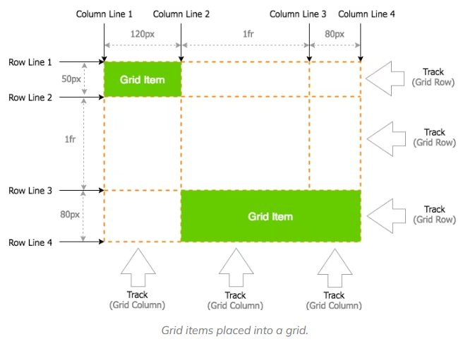
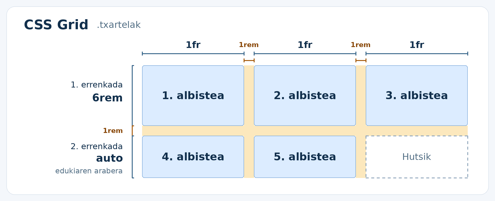
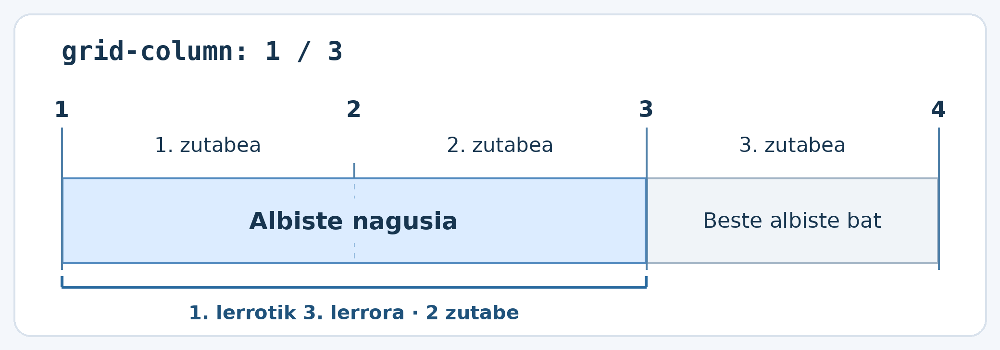
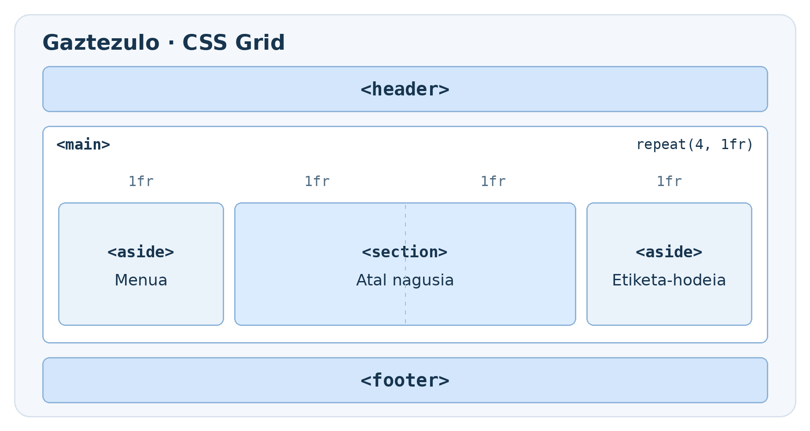
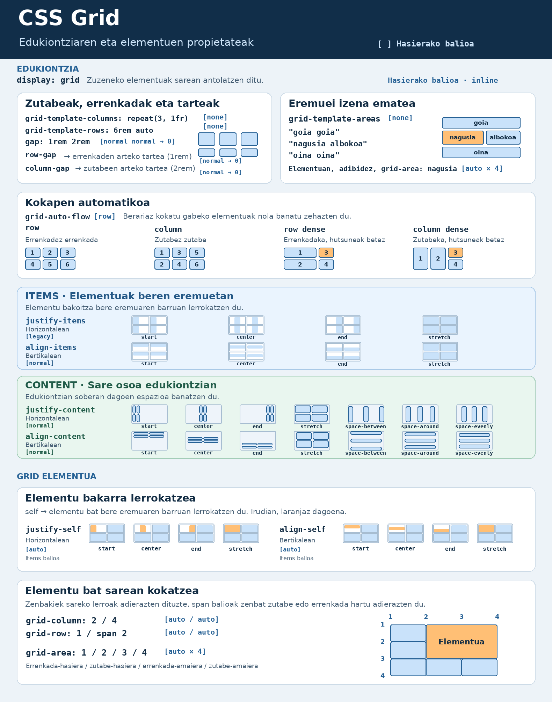

# CSS Grid

CSS Grid se utiliza para organizar elementos en **filas y columnas**.
Por ejemplo, podemos usarlo para distribuir tarjetas de noticias en tres
columnas o para colocar la cabecera, el contenido principal y una barra
lateral de una página web.

!!! tip "¿Flexbox o Grid?"

    Usa **Flexbox** para organizar elementos en una dirección, por ejemplo,
    para colocar en una fila los enlaces de un menú. Usa **Grid** cuando
    quieras controlar filas y columnas a la vez, por ejemplo, para alinear
    tarjetas en columnas.

## Grid: conceptos básicos

Al empezar a trabajar con Grid Layout, hay tres términos clave que conviene
entender antes de profundizar en los detalles:

- **Grid Container (contenedor Grid)**: es el contenedor principal del diseño.
  Al aplicarle `display: grid`, todos sus hijos directos se convierten en
  elementos Grid o *Grid Items*.
- **Grid Item (elemento Grid)**: son los hijos directos del contenedor Grid
  y se colocan en las celdas que este crea.
- **Grid Line (línea de Grid)**: son las líneas que definen las filas y las
  columnas de la cuadrícula.

La combinación de estos conceptos básicos con las propiedades CSS es donde
empieza la magia: `grid-template-columns`, `grid-template-rows`,
`grid-column-start`, `grid-column-end` y `grid-column`.



## El contenedor y los elementos Grid

`display: grid` se aplica al **elemento padre**. Este se convierte en el
**contenedor Grid**, y sus **hijos directos** son los **elementos Grid**.

### Ejemplo: tarjetas en tres columnas

```html
<section class="tarjetas">
    <article>Noticia 1</article>
    <article>Noticia 2</article>
    <article>Noticia 3</article>
    <article>Noticia 4</article>
    <article>Noticia 5</article>
</section>
```

```css
.tarjetas {
    display: grid;
    grid-template-columns: repeat(3, 1fr);
    gap: 1rem;
}

.tarjetas > article {
    padding: 1rem;
    background-color: #e8f1fa;
}
```

El navegador coloca las tarjetas en el orden del HTML. Cuando completa la
primera fila, crea automáticamente la siguiente.

| Columna 1 | Columna 2 | Columna 3 |
| --- | --- | --- |
| Noticia 1 | Noticia 2 | Noticia 3 |
| Noticia 4 | Noticia 5 | |

!!! note "Hijos directos"

    En el ejemplo, `section` es el contenedor y los elementos `article` son
    los que se colocan en la cuadrícula. Si añadimos un `h2` dentro de un
    `article`, el título queda dentro de la tarjeta.

## Columnas, filas y espacios

### Ancho de las columnas

Cada valor de la propiedad `grid-template-columns` define una columna.
La unidad `fr` representa una fracción del espacio libre de Grid. Antes de
repartir ese espacio, se descuenta el ocupado por las medidas fijas y los
espacios entre elementos.

| Valor | Resultado |
| --- | --- |
| `1fr 1fr 1fr` | Tres columnas; cada una ocupa una parte del espacio disponible. |
| `repeat(3, 1fr)` | Forma abreviada de la opción anterior. |
| `2fr 1fr` | Dos columnas; la primera ocupa dos partes y la segunda una. |
| `220px 1fr` | La primera columna ocupa 220 px y la segunda, el espacio restante. |

### Altura de las filas

La propiedad `grid-template-rows` define la altura de las filas. Si quieres
que las filas crezcan según su contenido, deja la altura sin especificar.

```css
.tarjetas {
    display: grid;
    grid-template-columns: repeat(3, 1fr);
    grid-template-rows: 6rem auto;
    gap: 1rem;
}
```



La primera fila tiene una altura de `6rem`. La altura de la segunda se
calcula según su contenido. Si se añaden más tarjetas, Grid crea
automáticamente más filas.

### Espacio entre elementos

La propiedad `gap` establece el espacio **entre** las filas y las columnas;
en la imagen anterior, es el espacio que aparece en naranja. Si también
quieres espacio en los bordes del contenedor, utiliza `padding`.

```css
gap: 1rem;         /* El mismo espacio en ambas direcciones */
gap: 1rem 2rem;    /* 1rem entre filas y 2rem entre columnas */
```

## Hacer que la noticia principal ocupe dos columnas

La sección de noticias tiene tres columnas. Queremos que **la noticia
principal ocupe las dos primeras columnas** y que la otra noticia aparezca
en la tercera.

```html
<section class="noticias">
    <article class="principal">Noticia principal</article>
    <article>Otra noticia</article>
</section>
```

```css
.noticias {
    display: grid;
    grid-template-columns: repeat(3, 1fr);
}

.principal {
    grid-column: 1 / 3;
}
```

Al principio y al final de las columnas hay **líneas de columna**. La
primera columna está **entre las líneas 1 y 2**, y la segunda, **entre las
líneas 2 y 3**.

Al escribir `grid-column: 1 / 3`, la noticia principal **empieza en la
línea 1 y termina en la línea 3**. Ese espacio abarca dos columnas.



!!! note "¿Y en las filas?"

    La propiedad `grid-row` utiliza las líneas de las filas. Por ejemplo,
    al escribir `grid-row: 1 / 3`, el elemento ocupa las dos primeras filas.

## Ejemplo: maquetar una página web

La cabecera y el pie de página ocupan todo el ancho. En el centro, el
contenido principal ocupa dos partes y la barra lateral, una. En pantallas
estrechas, todas las secciones aparecen en una sola columna, en el orden
del HTML.

```html
<body>
    <header></header>

    <main class="maquetacion">
        <aside aria-label="Menú"></aside>

        <section class="seccion-principal" aria-label="Sección principal"></section>

        <aside aria-label="Nube de etiquetas"></aside>
    </main>

    <footer></footer>
</body>
```

```css
header,
footer {
    min-height: 4rem;
    background-color: #d3e6fb;
}

.maquetacion {
    display: grid;
    grid-template-columns: repeat(4, 1fr);
    gap: 1rem;
    margin-block: 1rem;
}

.maquetacion > aside {
    min-height: 12rem;
    background-color: #eaf2fa;
}

.seccion-principal {
    grid-column: 2 / 4;
    background-color: #dcecff;
}
```



## Otras propiedades de Grid

En el ejemplo, hemos utilizado `grid-template-columns` para crear las
columnas y `grid-column` para que la sección principal ocupe dos de ellas.
Grid también tiene propiedades para alinear elementos y distribuir el
espacio dentro de la cuadrícula.

Para interpretar la imagen, fíjate en **qué es lo que se mueve**:

- **Todos los elementos, cada uno dentro de su área** → `justify-items`
  para alinearlos horizontalmente y `align-items` para alinearlos
  verticalmente.
- **Un solo elemento dentro de su área** → `justify-self` para alinearlo
  horizontalmente y `align-self` para alinearlo verticalmente.
- **Toda la cuadrícula dentro del contenedor** → `justify-content` para
  distribuir el espacio horizontal sobrante y `align-content` para
  distribuir el espacio vertical sobrante.


