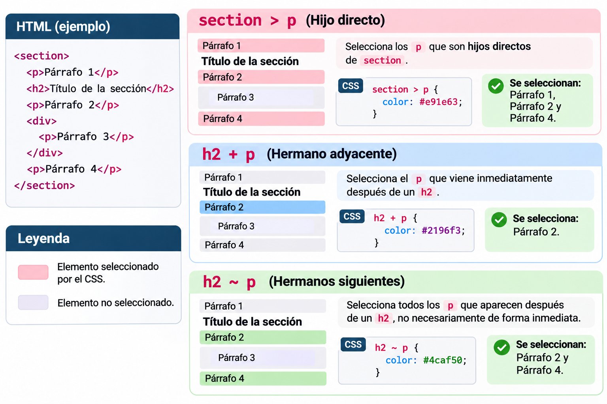
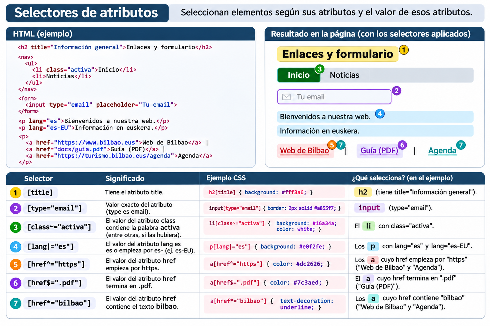

# CSS: selectores, cascada y herencia

Con CSS podemos cambiar la apariencia de los elementos HTML. Para ello, primero necesitamos indicar **a qué elementos** queremos aplicar el estilo: esa es la función del **selector**.

!!! info "Aprende y practica"
    En cada explicación encontrarás HTML, CSS y el resultado esperado. Luego, usa [el laboratorio de selectores CSS (54 ejercicios)](https://css-hautatzaileen-laborategia.jone-m.chatgpt.site) para practicar lo aprendido.

## 1. Estructura de una regla CSS

```css
h1 {
    color: darkblue;
    font-size: 2rem;
}
```

- `h1`: **selector**; qué elemento seleccionar
- `color` y `font-size`: **propiedades**; qué cambiar
- `darkblue` y `2rem`: **valores**; cómo cambiarlo
- `propiedad: valor;`: **declaración**; dentro de las llaves puede haber más de una declaración

!!! tip "Recuerda"
    Los selectores indican **a quién** se aplicarán; las declaraciones indican **qué estilo** se aplicará.

## 2. Selectores básicos

| Selector | Ejemplo | ¿Qué selecciona? |
|---|---|---|
| Elemento | `p` | Todos los elementos `p` |
| Clase | `.aviso` | Elementos con `class="aviso"` |
| ID | `#principal` | El elemento con `id="principal"` |
| Universal | `*` | Todos los elementos |
| Agrupación | `h1, h2, p` | Cualquier elemento que coincida con cualquiera de los tres selectores |

### 2.1. Elementos y clases

=== "HTML"
    ```html
    <h2>Noticias</h2>
    <p>Primera noticia</p>
    <p class="destacada">Noticia importante</p>
    <p>Otra noticia</p>
    ```

=== "CSS"
    ```css
    p { color: #333; }
    .destacada {
        color: #a10043;
        font-weight: bold;
    }
    ```

=== "Resultado"
    <div style="border:1px solid #ddd;padding:1rem;border-radius:8px">
      <h3 style="margin-top:0">Noticias</h3>
      <p style="color:#333">Primera noticia</p>
      <p style="color:#a10043;font-weight:bold">Noticia importante</p>
      <p style="color:#333">Otra noticia</p>
    </div>

**¿Por qué?** El selector `p` selecciona los tres párrafos; el selector `.destacada`, en cambio, selecciona solo el que tiene esa clase. En este último, la regla que define `color` es más específica.

### 2.2. Clase y tipo de elemento a la vez

```css
.destacada { color: red; }    /* Cualquier elemento con esa clase */
p.destacada { color: blue; }  /* Solo los elementos p con esa clase */
```

La misma clase puede usarse en varios elementos. Los IDs, en cambio, deben ser **únicos dentro del mismo documento HTML**. Para aplicar estilos generales, normalmente es recomendable **usar clases**, porque son más reutilizables.

### 2.3. Selector universal

```css
*{
    box-sizing: border-box;
}
```

Así, al calcular el ancho y la altura de los elementos, se tienen en cuenta el `padding` y el `border`. Es algo habitual en proyectos. Sin embargo, hay que usar con cuidado resets generales como `* { margin: 0; padding: 0; border: 0; }`: también eliminan los estilos útiles del navegador.

## 3. Selectores de relación

Estos selectores se basan en la **estructura** del HTML.

| Sintaxis | Nombre | ¿Qué selecciona? |
|---|---|---|
| `section p` | Descendiente | Todos los `p` dentro de un `section`, a cualquier profundidad |
| `section > p` | Hijo directo | Los `p` que son hijos directos del elemento `section` |
| `h2 + p` | Hermano adyacente | El `p` que viene **inmediatamente** después de un `h2` |
| `h2 ~ p` | Hermanos siguientes | Los `p` que aparecen después de un `h2`, no necesariamente de forma inmediata |



### 3.1. Comparando descendiente (` `) y hijo directo (`>`) 

=== "HTML"
    ```html
    <section>
        <p>A: hijo directo</p>
        <div>
            <p>B: descendiente</p>
        </div>
        <p>C: hijo directo</p>
    </section>
    ```

=== "CSS: dos opciones"
    ```css
    section p { color: blue; }   /* A, B y C */
    section > p { color: red; } /* A y C */
    ```

=== "Resultado"
    <div style="border:2px solid #aaa;padding:12px;border-radius:8px">
      <small>section</small>
      <p style="color:#b42318;font-weight:600">A: hijo directo — rojo</p>
      <div style="border:1px dashed #aaa;padding:10px;margin:8px 0"><small>div</small><p style="color:#1456b8">B: descendiente — azul</p></div>
      <p style="color:#b42318;font-weight:600">C: hijo directo — rojo</p>
    </div>

!!! note "Cuidado con el resultado"
    Si se aplican ambas reglas CSS **a la vez**, A y C serán rojos porque la regla `section > p` está escrita después y ambos selectores tienen la misma especificidad. B será azul.

### 3.2. Hermano adyacente (`+`) y hermanos siguientes (`~`)

=== "HTML"
    ```html
    <h2>Programa</h2>
    <p>Primer párrafo</p>
    <div>Información adicional</div>
    <p>Segundo párrafo</p>
    ```

=== "CSS"
    ```css
    h2 + p { color: red; }  /* Solo el primer p */
    h2 ~ p { font-weight: bold; } /* Los dos p */
    ```

=== "Resultado"
    <div style="border:1px solid #ddd;padding:12px;border-radius:8px">
      <strong>Programa</strong>
      <p style="color:#b42318;font-weight:bold">Primer párrafo (rojo y en negrita)</p>
      <div>Información adicional</div>
      <p style="font-weight:bold">Segundo párrafo (en negrita)</p>
    </div>

Ambos elementos deben tener el **mismo padre** para ser hermanos. El selector `+` selecciona al hermano adyacente inmediato; el selector `~`, en cambio, selecciona a todos los hermanos que aparecen después, siempre que coincidan con el selector.

## 4. Selectores de atributos

Estos selectores analizan los atributos y los valores de los elementos HTML.

| Selector | Significado | Ejemplo |
|---|---|---|
| `[title]` | Tiene el atributo `title` | `[title]` |
| `[type="email"]` | Valor exacto | `input[type="email"]` |
| `[class~="activa"]` | Una palabra separada | `[class~="activa"]` |
| `[lang|="es"]` | Empieza por `es` o `es-` | `[lang|="es"]` |
| `[href^="https"]` | El valor empieza por ese texto | `a[href^="https"]` |
| `[href$=".pdf"]` | El valor termina por ese texto | `a[href$=".pdf"]` |
| `[href*="bilbao"]` | El valor contiene ese texto | `a[href*="bilbao"]` |



### Ejemplo útil: distinguir enlaces PDF

=== "HTML"
    ```html
    <a href="programa.pdf">Programa (PDF)</a>
    <a href="contacto.html">Contacto</a>
    ```

=== "CSS"
    ```css
    a[href$=".pdf"] {
        color: #b42318;
        font-weight: bold;
    }
    ```

=== "Resultado"
    <div style="padding:12px;border:1px solid #ddd;border-radius:8px;display:flex;gap:18px;flex-wrap:wrap">
      <span style="color:#b42318;font-weight:bold;text-decoration:underline">Programa (PDF)</span>
      <span style="color:#1456b8;text-decoration:underline">Contacto</span>
    </div>

!!! warning "Detalle importante"
    El selector `[href$=".pdf"]` **no** selecciona una URL que termine en `.pdf?download=1`. El selector analiza el texto del atributo, no el tipo real del archivo.

## 5. Pseudoclases (`:`)

Las pseudoclases indican el **estado** o la **posición** de un elemento.

### 5.1. Interacción del usuario

| Pseudoclase | ¿Cuándo se aplica? |
|---|---|
| `:hover` | Cuando el cursor está sobre el elemento |
| `:focus` | Cuando el elemento tiene foco |
| `:focus-visible` | Cuando el navegador considera apropiado mostrar el indicador de foco |
| `:active` | Cuando el elemento está activándose (por ejemplo, al hacer clic) |
| `:checked` | Cuando una casilla o un radio están marcados |
| `:disabled` | Cuando un control de formulario está deshabilitado |

```css
nav a:hover { color: #b42318; }
nav a:focus-visible {
    outline: 3px solid #f0b429;
    outline-offset: 3px;
}
```

!!! tip "Accesibilidad"
    No elimines el indicador de foco con `outline: none` sin proporcionar otra indicación visual. Los usuarios que navegan con teclado deben poder ver dónde está el foco. Usar solo `:hover` no es suficiente.

### 5.2. Posición de los elementos

| Pseudoclase | ¿Qué selecciona? |
|---|---|
| `:first-child` | El primer elemento hijo del padre |
| `:last-child` | El último elemento hijo del padre |
| `:only-child` | El único elemento hijo del padre |
| `:nth-child(2)` | El segundo elemento hijo del padre |
| `:nth-child(odd)` | Los hijos en posiciones impares |
| `:nth-child(even)` | Los hijos en posiciones pares |
| `:nth-of-type(2)` | El segundo elemento del mismo tipo, entre hermanos |

=== "HTML"
    ```html
    <ul>
        <li>Primero</li>
        <li>Segundo</li>
        <li>Tercero</li>
        <li>Cuarto</li>
    </ul>
    ```

=== "CSS"
    ```css
    li:nth-child(2) { background: lightgreen; }
    li:nth-child(even) { font-weight: bold; }
    ```

=== "Resultado"
    <div style="border:1px solid #ddd;padding:12px;border-radius:8px">
      <div style="padding:6px">• Primero</div>
      <div style="padding:6px;background:#c8edc6;color:#164b23;font-weight:bold">• Segundo</div>
      <div style="padding:6px">• Tercero</div>
      <div style="padding:6px;font-weight:bold">• Cuarto</div>
    </div>

!!! warning "`nth-child` y `nth-of-type` no son lo mismo"
    ```html
    <div>
        <h2>Título</h2>
        <p>Primer párrafo</p>
        <p>Segundo párrafo</p>
    </div>
    ```
    - `p:nth-child(2)` → **primer párrafo** (el segundo hijo del `div`)
    - `p:nth-of-type(2)` → **segundo párrafo** (el segundo elemento `p`)

### 5.3. Negación: `:not()`

```css
/* li elementos sin la clase .especial */
li:not(.especial) { color: #555; }
```

`:not()` es útil para indicar excepciones. Sin embargo, se deben usar con cuidado reglas muy generales, como `:not(p)`, porque pueden afectar a muchos elementos que no esperabas.

## 6. Pseudoelementos (`::`)

Los pseudoelementos seleccionan **una parte** de un elemento o su **contenido generado**.

| Pseudoelemento | Uso |
|---|---|
| `::first-letter` | Primera letra de un bloque de texto |
| `::first-line` | Primera línea de un bloque de texto (puede variar según el ancho) |
| `::before` | Contenido generado al inicio del elemento |
| `::after` | Contenido generado al final del elemento |
| `::selection` | Texto seleccionado por el usuario |
| `::placeholder` | Texto de ejemplo de un campo del formulario |

=== "HTML"
    ```html
    <p class="aviso">Cuidado: la entrega final es el viernes.</p>
    ```

=== "CSS"
    ```css
    .aviso::before {
        content: "⚠ ";
        color: darkorange;
    }
    .aviso::first-letter {
        font-weight: bold;
    }
    ```

=== "Resultado"
    <div style="padding:12px;border:1px solid #ddd;border-radius:8px"><span style="color:#b66a00">⚠ </span><strong>C</strong>uidado: la entrega final es el viernes.</div>

!!! note "Contenido y presentación"
    Los elementos `::before` y `::after` necesitan la propiedad `content` para mostrar el contenido generado. No uses contenido generado por CSS como única forma de proporcionar información esencial; la información importante debe estar en HTML.

## 7. Cascada: cuando dos reglas modifican el mismo elemento

CSS combina varias reglas. Cuando una misma propiedad entra en conflicto, la **cascada** decide qué valor se aplica.

Para los principiantes, lo primero es hacer estas preguntas:

1. ¿Se aplican las dos reglas al mismo elemento?
2. ¿Ambas modifican la misma propiedad?
3. ¿Cuál es el origen, la importancia y la capa de las reglas?
4. Si las reglas tienen la misma capa e importancia, ¿cuál tiene **más especificidad**?
5. Si la especificidad es igual, ¿cuál aparece **más tarde**?

### 7.1. Especificidad: patrón

| Selector | ID | Clase / atributo / pseudoclase | Elemento / pseudoelemento |
|---|---:|---:|---:|
| `p` | 0 | 0 | 1 |
| `.aviso` | 0 | 1 | 0 |
| `p.aviso` | 0 | 1 | 1 |
| `#principal` | 1 | 0 | 0 |
| `#principal p.aviso` | 1 | 1 | 1 |

La especificidad se compara **columna por columna, de izquierda a derecha**: un ID va antes que cualquier cantidad de clases. No es una suma decimal. Los estilos en línea (`style="..."`) tienen prioridad propia frente a los selectores normales de la hoja de estilos; `!important`, las capas y los orígenes pueden alterar el resultado.

=== "HTML"
    ```html
    <p id="mensaje" class="aviso">¡Hola!</p>
    ```

=== "CSS"
    ```css
    p { color: black; }
    .aviso { color: blue; }
    #mensaje { color: red; }
    ```

=== "Resultado"
    <div style="border:1px solid #ddd;padding:12px;border-radius:8px"><span style="color:#b42318;font-weight:bold">¡Hola! (rojo)</span></div>

**¿Por qué?** Las tres reglas seleccionan el párrafo, pero el selector `#mensaje` tiene mayor especificidad.

### 7.2. Especificidad igual: orden

```css
.aviso { color: blue; }
.aviso { color: green; } /* Esta gana */
```

Como ambas reglas tienen el mismo origen, importancia, capa y especificidad, se aplica la **última**.

### 7.3. `!important`: con cuidado

```css
.aviso { color: red !important; }
```

`!important` no es una solución habitual: cambia el orden de prioridad de la cascada y puede complicar cambios posteriores. Primero, comprueba los selectores, la especificidad y el orden de las reglas.

!!! info "Más adelante: `@layer`"
    En CSS moderno, `@layer` permite organizar los estilos en capas. El orden de las capas puede influir en la cascada antes que la especificidad. Para empezar, basta con saber que **la especificidad no es la única respuesta a todos los conflictos**.

## 8. Herencia: ¿qué heredan los hijos?

Algunos elementos HTML **heredan** los valores de las propiedades CSS del padre.

=== "HTML"
    ```html
    <div class="caja">
        <h2>Título</h2>
        <p>Párrafo</p>
    </div>
    ```

=== "CSS"
    ```css
    .caja {
        color: darkgreen;
        font-family: Arial, sans-serif;
        border: 2px solid green;
    }
    ```

=== "Resultado"
    <div style="border:2px solid green;padding:12px;border-radius:6px;color:darkgreen;font-family:Arial,sans-serif"><h3 style="color:inherit;margin-top:0">Título</h3><p style="color:inherit">Párrafo</p></div>

`color` y `font-family` suelen heredarse; `border`, `margin`, `padding`, `width` y `background-color`, normalmente, **no**. Por eso, en el ejemplo el texto de los hijos es verde, pero no tienen cada uno un borde verde propio.

| Valor | ¿Qué hace? |
|---|---|
| `inherit` | Usa el valor calculado del padre |
| `initial` | Usa el valor inicial de la propiedad CSS |
| `unset` | Si es heredable, usa `inherit`; en caso contrario, `initial` |
| `revert` | Revierte el efecto de la fuente actual, según la cascada |

```css
.caja p { color: inherit; }
```

!!! warning "La herencia no es el selector"
    La regla `.caja p` selecciona directamente el párrafo. En cambio, la regla `.caja { color: green; }` selecciona la caja y el párrafo puede recibir el color **por herencia**. Son dos mecanismos distintos.

## 9. Selectores CSS modernos (complementario)

### 9.1. `:is()` — agrupar opciones

```css
:is(header, footer) a {
    color: white;
}
```

Selecciona los enlaces dentro de `header` o `footer`. En cuanto a la especificidad, los selectores dentro de `:is()` tienen efecto según el **más específico**.

### 9.2. `:where()` — sin añadir especificidad

```css
:where(header, footer) a {
    text-decoration: none;
}
```

Hace una agrupación similar, pero `:where()` tiene **0 de especificidad** sin importar cuán específicos sean los selectores internos. Por eso es útil para sobreescribir estilos básicos con facilidad.

### 9.3. `:has()` — seleccionar según elementos internos

=== "HTML"
    ```html
    <article class="tarjeta">
        <h2>Concierto</h2>
        
    </article>
    <article class="tarjeta">
        <h2>Nota</h2>
        <p>No hay imagen</p>
    </article>
    ```

=== "CSS"
    ```css
    .tarjeta:has(img) {
        border: 2px solid purple;
    }
    ```

=== "Resultado"
    <div style="display:flex;gap:12px;flex-wrap:wrap">
      <div style="border:2px solid purple;padding:12px;border-radius:6px;flex:1;min-width:130px"><strong>Concierto</strong><div style="background:#e9dafa;color:#4c2670;padding:15px;margin-top:8px">Imagen presente</div></div>
      <div style="border:1px solid #bbb;padding:12px;border-radius:6px;flex:1;min-width:130px"><strong>Nota</strong><p>No hay imagen</p></div>
    </div>

**¿Por qué?** El primer elemento `article` tiene una `img` dentro; el segundo no. El selector `:has()` selecciona el **article** completo, no la imagen.

!!! note "A este nivel"
    Es recomendable conocer `:is()`, `:where()` y `:has()`, pero primero debemos dominar los selectores básicos y la cascada.

## 10. Errores frecuentes y recomendaciones

| Error | Cómo corregirlo |
|---|---|
| Pensar que `p:nth-child(2)` es el segundo `p` | Debe ser el **segundo hijo** del padre; comparar con `:nth-of-type(2)` |
| Confundir `section p` y `section > p` | El primero selecciona todos los descendientes; el segundo solo los hijos directos |
| Usar IDs para todos los estilos | Para estilos reutilizables, normalmente conviene usar clases |
| Usar `!important` continuamente | Estudiar los selectores, la especificidad y la cascada |
| Diseñar solo con `:hover` | También considerar `:focus-visible` |
| Usar `* { margin:0; padding:0; border:0 }` automáticamente | Entender las consecuencias del reset y cambiar solo lo necesario |
| Usar contenido generado por CSS como única información | Escribir la información importante en HTML |

## 11. Resumen

- **Los selectores** eligen los elementos
- **Los selectores de relación** usan la estructura del HTML
- **Las pseudoclases** indican estados y posiciones
- **Los pseudoelementos** seleccionan partes de un elemento o contenido generado
- **La cascada y la especificidad** ayudan a resolver conflictos
- **La herencia** transmite valores de algunas propiedades del padre al hijo

### Para practicar

[**Abrir laboratorio de selectores CSS — 54 ejercicios**](https://css-hautatzaileen-laborategia.jone-m.chatgpt.site){ .md-button .md-button--primary }

Antes de hacer los ejercicios del laboratorio, intenta explicar **por qué** la respuesta es correcta. Que un selector funcione no es suficiente: el objetivo es entender qué elementos selecciona.

### Más referencias

- [MDN — CSS selectors](https://developer.mozilla.org/en-US/docs/Web/CSS/CSS_selectors)
- [MDN — Cascade](https://developer.mozilla.org/en-US/docs/Web/CSS/CSS_cascade/Cascade)
- [MDN — Inheritance](https://developer.mozilla.org/en-US/docs/Web/CSS/CSS_cascade/Inheritance)
- [W3Schools — CSS selectors](https://www.w3schools.com/css/css_selectors.asp)
