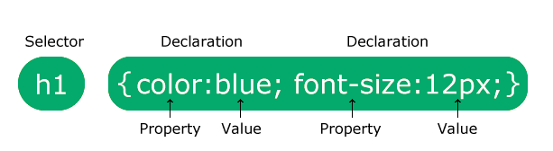
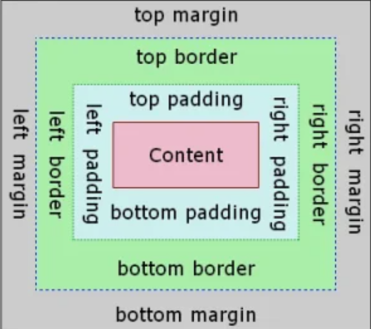
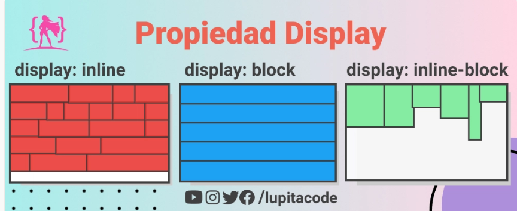

# CSS

CSS (**Cascading Style Sheets**) es el lenguaje que se utiliza para definir la **apariencia y el diseño** de una página web.

Usamos HTML para definir la estructura y el contenido de un documento; con CSS, en cambio, podemos modificar la apariencia de esos elementos.

Por ejemplo, en este documento HTML:

``` html
<h1>Mi primera página web</h1>
<p>Este es un párrafo.</p>
```

Con CSS, podemos cambiar el color del título y el tamaño del párrafo:

``` css
h1 {
    color: blue;
}

p {
    font-size: 18px;
}
```

!!! tip "HTML y CSS"

    **HTML → estructura y contenido**

    **CSS → apariencia y diseño**

## Sintaxis CSS

Una regla CSS tiene un **selector** y una o más declaraciones:

``` css
p {
    color: blue;
    font-size: 18px;
}
```

-   `p` → **selector**: indica a qué elemento se aplicará el estilo.
-   `color`, `font-size` → **propiedades**: indican qué queremos cambiar.
-   `blue`, `18px` → **valores**: indican qué valor tendrá la propiedad.

Cada declaración tiene esta estructura:

``` css
propiedad: valor;
```

Las declaraciones se escriben entre llaves `{ }`:

``` css
selector {
    propiedad: valor;
    propiedad: valor;
}
```



!!! note "Ten en cuenta"

    La propiedad y el valor se separan con `:`, y al final de cada declaración se usa `;`.

## CSS en un documento HTML

Podemos añadir CSS a un documento HTML de tres formas.

### Estilos en línea

CSS se escribe directamente en el atributo `style` del elemento HTML:

``` html
<p style="color: blue;">Párrafo azul</p>
```

Aunque este método puede usarse, **no es recomendable para definir el estilo general de una página web**, porque mezcla la estructura HTML con los estilos CSS.

### Hoja de estilos interna

El código CSS puede escribirse dentro del elemento `<style>` del `<head>` del documento:

``` html
<head>
    <style>
        p {
            color: blue;
        }
    </style>
</head>
```

Este método puede resultar útil para definir unos pocos estilos en una sola página.

### Hoja de estilos externa

Lo más habitual y recomendable es guardar el código CSS en un archivo `.css` aparte.

Por ejemplo, un proyecto puede tener la siguiente estructura:

``` text
proyecto/
│
├── index.html
└── css/
    └── estilos.css
```

En el archivo `estilos.css`:

``` css
h1 {
    color: blue;
}

p {
    font-size: 18px;
}
```

Para enlazar el archivo CSS desde el documento HTML se usa el elemento `<link>`, dentro del `<head>`:

``` html
<head>
    <link rel="stylesheet" href="css/estilos.css">
</head>
```

!!! tip "Recomendación"

    En la medida de lo posible, **usaremos hojas de estilo externas**. Así mantenemos separados la estructura HTML y los estilos CSS, y el código queda más limpio y más fácil de mantener.

### Primer ejemplo

Crea la siguiente estructura:

``` text
primer-css/
│
├── index.html
└── css/
    └── estilos.css
```

`index.html`:

``` html
<!DOCTYPE html>
<html lang="es">
<head>
    <meta charset="UTF-8">
    <title>Mi primer CSS</title>
    <link rel="stylesheet" href="css/estilos.css">
</head>
<body>

    <h1>Mi primer CSS</h1>

    <p>Usando HTML creamos la estructura de la página web.</p>

    <p>Usando CSS cambiamos la apariencia de la página web.</p>

</body>
</html>
```

`estilos.css`:

``` css
h1 {
    color: darkblue;
}

p {
    color: #333;
    font-size: 18px;
}
```

Cambia los valores del archivo CSS y comprueba qué ocurre en el navegador.

!!! example "Pruébalo"

    Cambia la propiedad `color` del elemento `h1`.

    Añade `font-size: 40px;`.

    ¿Qué ocurre en el navegador?

## Selectores

[Selectores](hautatzaileak.md)

## Cascada, herencia y especificidad

A veces, un mismo elemento puede verse afectado por más de una regla CSS.

Por ejemplo:

``` css
p {
    color: blue;
}

.nabarmendua {
    color: red;
}
```

``` html
<p class="nabarmendua">¿De qué color seré?</p>
```

En este caso, el texto será **rojo**, porque el selector `.nabarmendua` es más específico que el selector `p`.

CSS utiliza varias reglas para decidir qué estilo aplicar:

-   **Especificidad**: los selectores más concretos tienen más prioridad.
-   **Orden**: si tienen la misma especificidad, la regla escrita más tarde tendrá prioridad.
-   **Herencia**: algunas propiedades se heredan del elemento padre a los elementos hijo.

Por ejemplo:

``` html
<section>
    <h2>Título</h2>
    <p>Párrafo</p>
</section>
```

``` css
section {
    color: blue;
}
```

Como `color` es una propiedad heredada, tanto `<h2>` como `<p>` también tendrán color azul.

!!! tip "Idea principal"

    No necesitamos memorizar el cálculo de la especificidad al detalle. Lo importante es comprender que **un elemento puede recibir varias reglas CSS** y que el navegador decide cuál aplicar.

## Colores

En CSS, los colores pueden expresarse de varias formas.

### Nombre del color

``` css
p {
    color: red;
}
```

### Notación hexadecimal

``` css
p {
    color: #ff0000;
}
```

También puede usarse la versión abreviada cuando se repiten dígitos:

``` css
p {
    color: #f00;
}
```

!!!note
    Para ver cómo se mezclan los colores hexadecimales, entra en el siguiente enlace:

    <a href="https://www.w3schools.com/css/css_colors_hex.asp" target="_blank">Css Colors Hex</a>

### RGB

El sistema RGB representa la cantidad de rojo (**Red**), verde (**Green**) y azul (**Blue**).

Cada valor va de `0` a `255`:

``` css
p {
    color: rgb(255, 0, 0);
}
```

También es posible especificar la transparencia:

``` css
p {
    color: rgb(255 0 0 / 50%);
}
```

!!! tip "Recomendación"

    No es necesario memorizar todos los códigos de color. Las herramientas de desarrollo y varios sitios web facilitan la elección del color.

    Por ejemplo:

    <a href="https://htmlcolorcodes.com/es/selector-de-color/" target="_blank">Selector de color</a><br/>
    <a href="https://imagecolorpicker.com/" target="_blank">Elegir el color de una imagen</a><br/>

## Unidades de medida

Muchas propiedades CSS necesitan una medida:

``` css
p {
    font-size: 18px;
}
```

Las unidades pueden ser **absolutas** o **relativas**.

### Unidades absolutas

La más habitual es `px`:

``` css
p {
    font-size: 18px;
}
```

Otras unidades absolutas son `cm`, `mm`, `in`, `pt` y `pc`, aunque se usan menos en el diseño web.

### Unidades relativas

Son muy útiles para crear diseños adaptables.

| Unidad | Referencia |
|----------|--------------|
| `%` | Porcentaje respecto a otra medida. |
| `em` | Respecto al tamaño de letra del elemento. |
| `rem` | Respecto al tamaño de letra de la raíz del documento (`html`). |
| `vw` | Respecto al ancho del navegador. |
| `vh` | Respecto a la altura del navegador. |

Por ejemplo:

``` css
html {
    font-size: 16px;
}

main {
    width: 80%; /* El 80 % del ancho del elemento padre */
}

h1 {
    font-size: 2rem; /* 2 × 16px = 32px */
}

article {
    font-size: 20px;
}

article p {
    font-size: 1.5em; /* 1.5 × 20px = 30px */
}

header {
    width: 100vw; /* El 100 % del ancho del viewport */
    min-height: 50vh; /* El 50 % de la altura del viewport */
}
```

!!! note

    En diseño web no usaremos una única unidad para todas las situaciones. La opción adecuada depende del elemento cuya medida estemos definiendo.

## Texto y tipografía

### Color del texto

La propiedad `color` define el color del texto:

``` css
p {
    color: #333;
}
```

### Tamaño de letra

``` css
p {
    font-size: 18px;
}
```

### Familia tipográfica

La propiedad `font-family` define el tipo de letra:

``` css
body {
    font-family: Arial, Helvetica, sans-serif;
}
```

Se recomienda indicar varios tipos de letra. Si el primero no está disponible, el navegador probará el siguiente.

Si el nombre contiene espacios, se escribe entre comillas:

``` css
body {
    font-family: "Times New Roman", serif;
}
```

### Grosor de letra

``` css
p {
    font-weight: bold;
}
```

También se puede indicar con un número:

``` css
h1 {
    font-weight: 700;
}
```

### Estilo de letra

``` css
p {
    font-style: italic;
}
```

### Alineación

``` css
p {
    text-align: center;
}
```

Valores habituales:

-   `left`
-   `right`
-   `center`
-   `justify`

### Interlineado

La propiedad `line-height` controla la distancia entre las líneas de texto:

``` css
p {
    line-height: 1.5;
}
```

### Decoración del texto

``` css
a {
    text-decoration: none;
}
```

Otros valores:

``` css
.azpimarratua {
    text-decoration: underline;
}

.marratua {
    text-decoration: line-through;
}
```

### Mayúsculas y minúsculas

``` css
h1 {
    text-transform: uppercase;
}
```

Los valores más utilizados:

-   `uppercase`
-   `lowercase`
-   `capitalize`
-   `none`

## Modelo de caja (Box Model)

Podemos representar todos los elementos HTML como **cajas**.

Cada caja tiene cuatro partes principales:

1.  **Content** → el contenido del elemento.
2.  **Padding** → el espacio interior entre el contenido y el borde.
3.  **Border** → el borde del elemento.
4.  **Margin** → el espacio exterior del elemento.



!!! note "W3Schools"
    Haz pruebas en el siguiente enlace para entender todas las partes:
    <a href="https://www.w3schools.com/css/tryit.asp?filename=trycss_boxmodel" target="_blank">CSS Box Model</a>

### Width y height

``` css
div {
    width: 300px;
    height: 150px;
}
```

`width` es el ancho del elemento y `height` es su altura.

### Padding

Es el espacio entre el contenido y el borde del elemento:

``` css
div {
    padding: 20px;
}
```

También se puede definir cada lado por separado:

``` css
div {
    padding-top: 10px;
    padding-right: 20px;
    padding-bottom: 10px;
    padding-left: 20px;
}
```

Forma abreviada:

``` css
div {
    padding: 10px 20px;
}
```

### Border

Para definir el borde de un elemento:

``` css
div {
    border-width: 2px;
    border-style: solid;
    border-color: black;
}
```

Normalmente se usa la forma abreviada:

``` css
div {
    border: 2px solid black;
}
```

Para redondear las esquinas:

``` css
div {
    border-radius: 10px;
}
```

### Margin

Define el espacio exterior del elemento:

``` css
div {
    margin: 20px;
}
```

También se puede definir cada lado por separado:

``` css
div {
    margin-top: 10px;
    margin-right: 20px;
    margin-bottom: 10px;
    margin-left: 20px;
}
```

Una forma habitual de centrar un elemento horizontalmente:

``` css
main {
    width: 80%;
    margin: 0 auto;
}
```

### `box-sizing`

Por defecto, al asignar `width` a un elemento, ese ancho indica **solo el ancho del contenido (`content`)**.

Por ejemplo:

```css
.kutxa {
    width: 300px;
    padding: 20px;
    border: 5px solid black;
}
```

En este caso, el ancho real del elemento **no es de 300px**:

- Content → `300px`
- Padding → `20px + 20px`
- Border → `5px + 5px`

Por tanto:

**300 + 40 + 10 = 350px**

El elemento tendrá un ancho total de **350px**.

Esto ocurre porque el valor predeterminado es `content-box`:

```css
box-sizing: content-box;
```

---

Si usamos `box-sizing: border-box`:

```css
.kutxa {
    box-sizing: border-box;
    width: 300px;
    padding: 20px;
    border: 5px solid black;
}
```

Ahora, el valor `width: 300px` indica el **ancho de toda la caja**.

Es decir:

**Content + Padding + Border = 300px**

El navegador reduce automáticamente el tamaño del contenido (`content`) para que el `padding` y el `border` quepan dentro de los 300px del elemento.

!!! tip "Recomendación"

    Por eso es muy habitual aplicar `border-box` a todos los elementos al principio del archivo CSS:

    ```css
    * {
        box-sizing: border-box;
    }
    ```

    Así, si asignamos `width: 300px` a un elemento, **sabemos que tendrá un ancho total de 300px**, aunque tenga `padding` o `border`.

!!! note "En resumen"
    **content-box: width = content**

    **border-box: width = content + padding + border**

    Como vemos, **margin** no se incluye en ninguno de los cálculos.

## Fondo

### Color de fondo

``` css
body {
    background-color: #f5f5f5;
}
```

### Imagen de fondo

``` css
header {
    background-image: url("../images/fondoa.jpg");
}
```

Las rutas relativas que se usan en el archivo CSS se calculan **desde la ubicación del propio archivo CSS**.

Por ejemplo:

``` text
proyecto/
│
├── index.html
├── css/
│   └── estilos.css
└── images/
    └── fondoa.jpg
```

Para llegar a la carpeta `images` desde el archivo `estilos.css`:

``` css
header {
    background-image: url("../images/fondoa.jpg");
}
```

Con las imágenes de fondo también se pueden usar otras propiedades:

``` css
header {
    background-image: url("../images/fondoa.jpg");
    background-repeat: no-repeat;
    background-position: center;
    background-size: cover;
}
```

## Propiedad `display`

La propiedad `display` define cómo se organiza un elemento en el documento.



### Elementos block

Los elementos `block` ocupan todo el ancho disponible y el siguiente elemento empieza en otra línea.

``` css
div {
    display: block;
}
```

Elementos HTML como `<div>`, `<p>`, `<section>` o `<h1>` son `block` por defecto.

### Elementos inline

Los elementos `inline` solo ocupan el espacio que necesitan para su contenido y no crean un salto de línea.

``` css
span {
    display: inline;
}
```

Elementos como `<span>` o `<a>` son `inline` por defecto.

### Inline-block

Los elementos `inline-block` pueden colocarse en la misma línea y permiten controlar las propiedades `width`, `height`, `padding` y `margin`.

``` css
a {
    display: inline-block;
    padding: 10px;
}
```

### Ocultar un elemento

``` css
.elementua {
    display: none;
}
```

El elemento no se mostrará y no ocupará espacio.

!!! note "A practicar"
    Practica en la página <a href="https://www.w3schools.com/css/css_display.asp" target="_blank">W3Schools - Display</a>.

!!! example "Ejercicio 1 - CSS"
    Recupera el Ejercicio 8B que hiciste en la sección de HTML y añádele estilos. Por ahora, incluiremos los estilos en la propia página.

## Flexbox

Flexbox es un sistema CSS que se usa para **organizar elementos en una fila o una columna**.

Para usar Flexbox, se aplica lo siguiente al elemento padre:

``` css
.edukiontzia {
    display: flex;
}
```

HTML:

``` html
<div class="edukiontzia">
    <div>1</div>
    <div>2</div>
    <div>3</div>
</div>
```

### Dirección

``` css
.edukiontzia {
    display: flex;
    flex-direction: row;
}
```

Valores principales:

-   `row`
-   `row-reverse`
-   `column`
-   `column-reverse`

### Alineación en el eje principal

La propiedad `justify-content` distribuye los elementos en el eje principal:

``` css
.edukiontzia {
    display: flex;
    justify-content: center;
}
```

Valores más utilizados:

-   `flex-start`
-   `flex-end`
-   `center`
-   `space-between`
-   `space-around`
-   `space-evenly`

### Alineación en el eje transversal

``` css
.edukiontzia {
    display: flex;
    align-items: center;
}
```

Valores más utilizados:

-   `stretch`
-   `flex-start`
-   `flex-end`
-   `center`

### Pasar los elementos a la siguiente línea

``` css
.edukiontzia {
    display: flex;
    flex-wrap: wrap;
}
```

### Espacio entre elementos

``` css
.edukiontzia {
    display: flex;
    gap: 20px;
}
```

!!! example "Pruébalo"

    Crea un contenedor con tres cajas y prueba diferentes valores de las propiedades `flex-direction`, `justify-content`, `align-items` y `gap`.

## Grid

CSS Grid se usa para organizar elementos en **filas y columnas**.

``` css
.edukiontzia {
    display: grid;
}
```

Por ejemplo, para crear tres columnas iguales:

``` css
.edukiontzia {
    display: grid;
    grid-template-columns: 1fr 1fr 1fr;
}
```

Forma más breve:

``` css
.edukiontzia {
    display: grid;
    grid-template-columns: repeat(3, 1fr);
}
```

Espacio entre los elementos:

``` css
.edukiontzia {
    display: grid;
    grid-template-columns: repeat(3, 1fr);
    gap: 20px;
}
```

!!! note "La unidad `fr`"

    `fr` es una unidad de Grid que representa una fracción del espacio disponible.

    Al usar `1fr 1fr 1fr`, el espacio se divide en tres partes iguales.

## Diseño adaptable

Las páginas web deben adaptarse a diferentes tamaños de pantalla: ordenadores, tabletas y móviles.

Para ello podemos utilizar, entre otras cosas, medidas relativas, Flexbox, Grid y **media queries**.

### Media queries

Una media query permite aplicar reglas CSS según una condición.

Por ejemplo:

``` css
.edukiontzia {
    display: grid;
    grid-template-columns: repeat(3, 1fr);
}

@media (max-width: 768px) {
    .edukiontzia {
        grid-template-columns: 1fr;
    }
}
```

Cuando el ancho de la pantalla es de `768px` o menos, en lugar de tres columnas tendremos una sola.

!!! tip "Idea principal"

    El diseño adaptable no es algo que se añada al final del sitio web. Debemos tener en cuenta desde el principio que la página se usará en pantallas de distintos tamaños.

## `float` y `clear`

La propiedad `float` permite desplazar un elemento a la izquierda o a la derecha; el contenido siguiente se coloca a su alrededor.

Por ejemplo, para colocar texto alrededor de una imagen:

``` css
img {
    float: left;
    margin-right: 15px;
}
```

Valores principales:

-   `none`
-   `left`
-   `right`

La propiedad `clear` se usa para controlar el efecto de un `float` anterior:

``` css
footer {
    clear: both;
}
```

!!! warning "¿`float` para maquetar?"

    Hace tiempo se usaba mucho `float` para maquetar páginas web.

    Hoy en día, **se recomienda usar Flexbox y Grid para colocar los elementos y maquetar la página**.

    `float` sigue siendo útil, por ejemplo, **para colocar texto alrededor de una imagen**.

## Enlaces útiles

-   [MDN: CSS](https://developer.mozilla.org/en-US/docs/Web/CSS){: target="_blank" rel="noopener" }
-   [MDN: selectores CSS](https://developer.mozilla.org/en-US/docs/Web/CSS/CSS_selectors){: target="_blank" rel="noopener" }
-   [MDN: modelo de caja CSS](https://developer.mozilla.org/en-US/docs/Learn_web_development/Core/Styling_basics/Box_model){: target="_blank" rel="noopener" }
-   [MDN: Flexbox](https://developer.mozilla.org/en-US/docs/Learn_web_development/Core/CSS_layout/Flexbox){: target="_blank" rel="noopener" }
-   [MDN: Grid](https://developer.mozilla.org/en-US/docs/Learn_web_development/Core/CSS_layout/Grids){: target="_blank" rel="noopener" }
