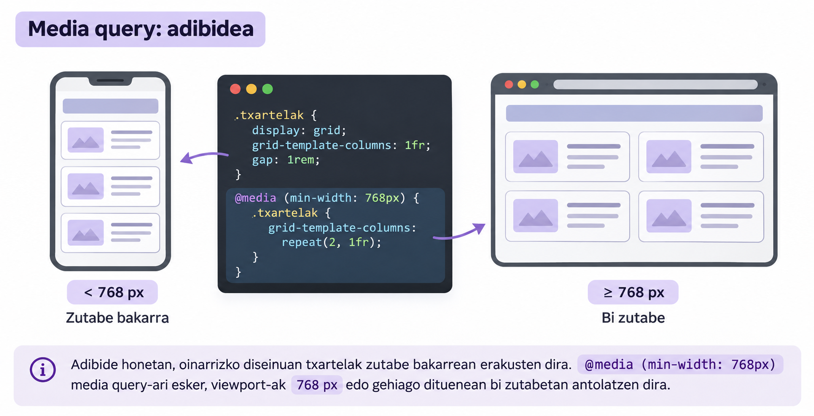

## Diseño adaptable (Responsive Design)

El diseño adaptable o *Responsive Web Design* consiste en ajustar la apariencia y la organización del contenido de un sitio web al tamaño de la pantalla. Así, se puede utilizar cómodamente en móviles, tabletas y ordenadores.

Para crear un diseño adaptable, podemos utilizar varias técnicas:

- **Unidades relativas:** para definir de forma flexible el tamaño de los elementos.
- **Imágenes adaptables:** para evitar que las imágenes se salgan de su contenedor.
- **Flexbox y Grid:** para organizar los elementos según el espacio disponible.
- **Media queries:** para cambiar los estilos según el ancho de la pantalla.

!!! tip "Idea principal"
    El diseño adaptable no es algo que se añada al final del sitio web. Debemos tener en cuenta desde el principio que se utilizará en pantallas de distintos tamaños.

## Viewport

El *viewport* es el área disponible en el navegador para ver una página web.

Para que el sitio web se adapte correctamente al ancho de la pantalla en móviles, añadimos esta etiqueta en la sección `<head>` del documento HTML:

```html
<meta name="viewport" content="width=device-width, initial-scale=1.0">
```

- `width=device-width`: adapta el ancho del viewport al ancho del dispositivo.
- `initial-scale=1.0`: muestra la página con la escala inicial, sin zoom adicional.

!!! note "Ten en cuenta"
    Esta etiqueta por sí sola no hace que el diseño sea adaptable: también tenemos que adaptar el CSS.

## Unidades relativas

En CSS podemos usar unidades fijas como `px`, pero las unidades relativas también son muy útiles en los diseños adaptables. Estas unidades se calculan tomando como referencia otra medida.

| Unidad | Significado | Ejemplo |
|---|---|---|
| `%` | Porcentaje de una medida de referencia; en la propiedad `width`, normalmente del ancho del contenedor | `width: 80%` |
| `rem` | Depende del tamaño de letra del elemento raíz (`html`) | `font-size: 1.5rem` |
| `em` | Depende del tamaño de letra; en `padding` toma como referencia el tamaño de letra del propio elemento | `padding: 2em` |
| `vw` | El 1 % del ancho del viewport | `width: 50vw` |
| `vh` | El 1 % de la altura del viewport | `height: 50vh` |

### Ejemplo

```css
main {
    width: 80%;
    max-width: 1200px;
    margin: auto;
    padding: 1rem;
}

h1 {
    font-size: 2rem;
}
```

- `width: 80%`: el elemento `main` ocupará el 80 % del ancho de su contenedor.
- `max-width: 1200px`: no tendrá más de 1200 px de ancho.
- `margin: auto`: ayuda a centrar el elemento horizontalmente.
- `padding: 1rem`: el espacio interior se calcula según el tamaño de letra del elemento raíz.

!!! note "Ten en cuenta"
    Es habitual usar juntos `width: 80%` y `max-width: 1200px`: el contenido se adapta en pantallas pequeñas y no se ensancha demasiado en pantallas grandes. `em` y `rem` no son iguales: `rem` toma como referencia el elemento raíz; la referencia de `em` depende de la propiedad.

## Imágenes adaptables

Si una imagen es más ancha que su contenedor, puede salirse de la pantalla. Para evitarlo:

```css
img {
    max-width: 100%;
    height: auto;
}
```

- `max-width: 100%`: la imagen no superará el ancho de su contenedor.
- `height: auto`: mantiene las proporciones de la imagen.

Así, las imágenes grandes se reducirán cuando sea necesario, pero no se ampliarán obligatoriamente hasta ocupar todo el ancho del contenedor.

## Media queries

Una *media query* permite aplicar reglas CSS según una condición. En el diseño adaptable, normalmente la usamos en función del ancho del viewport.

### Sintaxis

```css
@media (min-width: 768px) {
    /* Cuando el viewport tiene al menos 768 px */
}
```

La condición `min-width: 768px` significa que los estilos del bloque se aplicarán **a partir de un ancho de 768 px**.

### Breakpoints o puntos de ruptura

Un *breakpoint* es el ancho de pantalla que elegimos para cambiar el diseño. Por ejemplo, podemos usar `768px` cuando haya espacio suficiente para colocar los elementos uno al lado del otro.

!!! tip "¿Cómo elegir un breakpoint?"
    No hay una única medida válida para todos los móviles, tabletas y ordenadores. Elegiremos el punto de ruptura cuando no haya espacio suficiente para organizar bien el contenido.

### Mobile First

Con el enfoque *Mobile First*, primero se escriben los estilos para pantallas pequeñas y, después, se añaden adaptaciones para pantallas más grandes. Para ello, usamos `min-width`.

```css
/* Pantallas pequeñas: diseño básico */
.txartelak {
    display: grid;
    grid-template-columns: 1fr;
    gap: 1rem;
}

/* Pantallas más anchas */
@media (min-width: 768px) {
    .txartelak {
        grid-template-columns: repeat(2, 1fr);
    }
}
```

- **Menos de 768 px:** las tarjetas aparecen en una sola columna.
- **A partir de 768 px:** se organizan en dos columnas.



!!! note "Orden de las reglas CSS"
    Primero escribimos los estilos generales y, después, las media queries. Cuando se cumple la condición, las reglas de la media query pueden sustituir los valores anteriores, según la cascada y la especificidad.

## Flexbox y Grid en el diseño adaptable

Las media queries son útiles, pero a veces también podemos lograr un diseño adaptable solo con las propiedades de Flexbox y Grid.

### Flexbox: `flex-wrap`

```css
.txartelak {
    display: flex;
    flex-wrap: wrap;
    gap: 1rem;
}

.txartela {
    flex: 1 1 250px;
}
```

- `display: flex`: organiza las tarjetas mediante Flexbox.
- `flex-wrap: wrap`: cuando no hay espacio, los elementos pasan a la línea siguiente.
- `flex: 1 1 250px`: las tarjetas parten de un ancho base de unos 250 px y pueden crecer o reducirse según el espacio disponible.

### Grid: `auto-fit` y `minmax()`

```css
.txartelak {
    display: grid;
    grid-template-columns: repeat(auto-fit, minmax(250px, 1fr));
    gap: 1rem;
}
```

- `repeat()`: repite el patrón de columnas.
- `auto-fit`: crea las columnas que caben en el espacio disponible y las ajusta para ocuparlo.
- `minmax(250px, 1fr)`: cada columna tiene un ancho mínimo de 250 px y puede ampliarse si hay más espacio.

De esta forma, el navegador adapta automáticamente el número de columnas, sin necesidad de escribir media queries.

!!! note "Ten en cuenta"
    En este ejemplo de Grid, si el contenedor mide menos de 250 px de ancho, el contenido puede desbordarse. Por eso hay que probar el diseño también con anchos pequeños.

!!! tip "¿Qué técnica usar?"
    Si queremos que los elementos pasen automáticamente a otras filas o columnas, podemos usar `flex-wrap` o `auto-fit`. Si queremos cambiar la estructura o los estilos a partir de un ancho de pantalla determinado, podemos usar una media query. También se pueden combinar estas técnicas.

## Probar el diseño adaptable

Para comprobar si un sitio web es adaptable, podemos usar las herramientas de desarrollo del navegador:

1. Abre el sitio web en el navegador.
2. Pulsa `F12` para abrir las herramientas de desarrollo.
3. Activa la vista de dispositivos (*Device Toolbar* o *Responsive Design Mode*).
4. Cambia el ancho del viewport poco a poco.
5. Comprueba que los elementos se adaptan correctamente.

Fíjate especialmente en si el contenido se sale de la pantalla, aparece desplazamiento horizontal, los textos se leen bien y las imágenes se deforman.

!!! tip "Recuerda"
    Un sitio web adaptable no solo debe verse bien en móviles y ordenadores: también debe ser práctico en los anchos intermedios.
