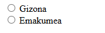
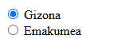
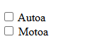
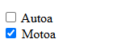
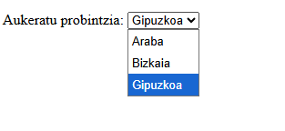
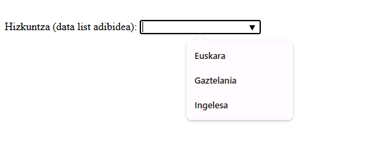

# Formularioak

Formularioak erabiltzailearen datuak jasotzeko erabiltzen dira. Adibidez, izena emateko, saioa hasteko, mezua idazteko edo inkesta bati erantzuteko erabil daitezke.

Formulario baten barruan hainbat kontrol egon daitezke: testu-eremuak, aukera-botoiak, egiaztapen-laukiak, zerrendak eta botoiak.

---

## `<form>` etiketa

`<form>` etiketak formulario bateko kontrolak biltzen ditu.

```html
<form>
    <!-- Formularioaren kontrolak -->
</form>
```

Formulario bat zerbitzari batera bidali behar denean, bi atributu hauek erabiltzen dira:

| Atributua | Azalpena |
|-----------|----------|
| `action` | Datuak bidaliko diren helbidea. |
| `method` | Datuak bidaltzeko metodoa, adibidez, `get` edo `post`. |

!!! note "Ikasgai honetan"
    Formularioak HTML bidez sortu eta nabigatzailean erabiliko ditugu. Adibideetako botoiek `type="button"` izango dute, datuak bidaltzeko ekintzarik egin gabe.

---

## `<label>` etiketa

`<label>` etiketak kontrol batean zer idatzi edo aukeratu behar den adierazten du. Etiketaren `for` atributuak eta kontrolaren `id` atributuak balio bera izan behar dute.

```html
<label for="izena">Izena</label>
<input type="text" id="izena" name="izena">
```

Egin klik **Izena** testuan. Kurtsorea testu-eremuan kokatuko da. `radio` eta `checkbox` kontroletan ere erabil daiteke lotura hori, aukeraren testuan klik eginda kontrola markatzeko.

---

## `id`, `name` eta `value`

| Atributua | Zertarako erabiltzen da? |
|-----------|--------------------------|
| `id` | Kontrola orrian identifikatzeko eta haren etiketa lotzeko. `id` bakoitza bakarra izan behar da orrian. |
| `name` | Kontrolaren datuari izena emateko. `radio` botoietan, talde bereko aukerek `name` bera dute. |
| `value` | Testu-eremu baten hasierako balioa ezartzeko edo aukera bati dagokion balioa adierazteko. |

```html
<label for="parte-hartzailea">Izena</label>
<input type="text" id="parte-hartzailea" name="izena" value="Jon">
```

Adibidean, `parte-hartzailea` etiketak kontrola aurkitzeko erabiltzen duen identifikatzailea da. `izena` datuaren izena da eta `Jon` hasieran eremuan agertzen den balioa. Kontrolaren `id` eta `name` berdinak izan daitezke, baina bakoitzak bere funtzioa du.

---

## Testu-eremua (`text`)

Testu laburrak idazteko erabiltzen da.

```html
<label for="erabiltzailea">Erabiltzaile-izena (nahitaezkoa)</label>
<input
    type="text"
    id="erabiltzailea"
    name="erabiltzailea"
    placeholder="Adibidez, jon"
    minlength="3"
    maxlength="20"
    required>
```

| Atributua | Azalpena |
|-----------|----------|
| `value` | Eremuaren hasierako balioa. |
| `placeholder` | Eremua hutsik dagoenean agertzen den laguntza-testua. |
| `size` | Eremuaren zabalera bisuala, gutxi gorabehera zenbat karaktere ikus daitezkeen adierazita. |
| `minlength` | Idatzitako testuak izan behar duen gutxieneko luzera. |
| `maxlength` | Idatz daitekeen gehieneko karaktere kopurua. |
| `required` | Eremua nahitaez bete behar dela adierazten du. |

Erabili `<label>` eremuaren izena beti ikusgai uzteko. `placeholder` atributua adibide labur bat emateko erabil daiteke.

---

## Pasahitza (`password`)

Idatzitako karaktereak pantailan ezkutatzen ditu.

```html
<label for="pasahitza">Pasahitza</label>
<input type="password" id="pasahitza" name="pasahitza">
```

---

## Helbide elektronikoa (`email`)

Helbide elektronikoa idazteko erabiltzen da. Nabigatzaileak idatzitako testuak helbide elektroniko baten formatua duen egiaztatzen du. `required` gehituz gero, eremua betetzea ere nahitaezkoa da.

```html
<label for="emaila">Helbide elektronikoa (nahitaezkoa)</label>
<input type="email" id="emaila" name="emaila" required>
```

---

## Beste `input` mota erabilgarri batzuk

| Mota | Erabilera |
|------|-----------|
| `number` | Zenbakiak sartzeko. |
| `date` | Data aukeratzeko. |
| `color` | Kolorea aukeratzeko. |
| `file` | Gailuko fitxategi bat aukeratzeko. |
| `range` | Balio bat barra baten bidez aukeratzeko. |

```html
<label for="data">Data</label>
<input type="date" id="data" name="data">

<label for="kopurua">Parte-hartzaile kopurua</label>
<input type="number" id="kopurua" name="kopurua" min="1" max="10">

<label for="kolorea">Kolore gogokoena</label>
<input type="color" id="kolorea" name="kolorea">

<label for="fitxategia">Aukeratu fitxategi bat</label>
<input type="file" id="fitxategia" name="fitxategia">

<label for="balorazioa">Balorazioa</label>
<input type="range" id="balorazioa" name="balorazioa" min="0" max="10">
```

---

## Aukera-botoiak (`radio`)

Talde bateko aukera **bakarra** hautatzeko erabiltzen dira. Talde bereko botoiek `name` bera dute. Aukera bakoitzak bere `id` eta `value` ditu.

`checked` atributuak hasieran zein aukera egongo den markatuta adierazten du.

```html
<fieldset>
    <legend>Zein txanda nahi duzu?</legend>

    <input type="radio" id="goiza" name="txanda" value="goiza" checked>
    <label for="goiza">Goizekoa</label>

    <input type="radio" id="arratsaldea" name="txanda" value="arratsaldea">
    <label for="arratsaldea">Arratsaldekoa</label>
</fieldset>
```





---

## Egiaztapen-laukiak (`checkbox`)

Lauki bakoitza bere aldetik markatu edo desmarkatu daiteke. Aukera-zerrenda batean, erabiltzaileak zero aukera, bat edo gehiago marka ditzake. `checked` atributua erabil daiteke lauki bat hasieran markatzeko.

```html
<fieldset>
    <legend>Zein garraiobide erabiltzen dituzu?</legend>

    <input type="checkbox" id="autoa" name="garraiobidea" value="autoa">
    <label for="autoa">Autoa</label>

    <input type="checkbox" id="motoa" name="garraiobidea" value="motoa" checked>
    <label for="motoa">Motoa</label>
</fieldset>
```





!!! tip "Probatu nabigatzailean"
    Sakatu **Arratsaldekoa** testuan eta ikusi goizeko aukera automatikoki desmarkatzen dela. Ondoren, markatu **Autoa** eta **Motoa**. Bi laukiak batera marka daitezke.

---

## Zerrenda zabalgarria (`select`)

`<select>` etiketak aukera-zerrenda bat sortzen du. Aukera bakoitza `<option>` etiketa batekin idazten da.

```html
<label for="lurraldea">Lurraldea</label>
<select id="lurraldea" name="lurraldea">
    <option value="araba">Araba</option>
    <option value="bizkaia">Bizkaia</option>
    <option value="gipuzkoa" selected>Gipuzkoa</option>
</select>
```



| Atributua | Non jartzen da? | Azalpena |
|-----------|------------------|----------|
| `value` | `<option>` | Aukerari dagokion balioa. |
| `selected` | `<option>` | Hasieran hautatuta agertuko den aukera. |
| `multiple` | `<select>` | Aukera bat baino gehiago hautatzeko aukera ematen du. |
| `required` | `<select>` | Aukera bat hautatzea nahitaezkoa dela adierazten du. |

Erabiltzaileak berak aukera bat egin behar duenean, jarri hasieran `value=""` duen aukera bat. Horrela, hasierako mezua ikusiko du zerrenda ireki aurretik.

```html
<label for="jarduera">Jarduera (nahitaezkoa)</label>
<select id="jarduera" name="jarduera" required>
    <option value="">Aukeratu jarduera bat</option>
    <option value="argazkilaritza">Argazkilaritza</option>
    <option value="antzerkia">Antzerkia</option>
</select>
```

Aukera bat baino gehiago hautatzeko:

```html
<label for="hizkuntza-aukerak">Hizkuntzak</label>
<select id="hizkuntza-aukerak" name="hizkuntza" multiple>
    <option value="eu">Euskara</option>
    <option value="es">Gaztelania</option>
    <option value="en">Ingelesa</option>
</select>
```

---

## Lerro anitzeko testu-eremua (`textarea`)

Mezuak, iruzkinak edo oharrak idazteko erabiltzen da.

```html
<label for="oharrak">Oharrak</label>
<textarea
    id="oharrak"
    name="oharrak"
    rows="6"
    cols="40"
    maxlength="200"
    placeholder="Idatzi zure oharrak"></textarea>
```

`rows` atributuak hasieran ikusiko diren lerro kopurua adierazten du, eta `cols` atributuak eremuaren gutxi gorabeherako zabalera. Hasierako testua jarri nahi baduzu, idatzi `<textarea>` eta `</textarea>` etiketen artean.

---

## Datu-iradokizunak (`datalist`)

Erabiltzaileak idazten duen bitartean iradokizunak erakusten ditu. `<input>` elementuaren `list` atributuak eta `<datalist>` elementuaren `id` atributuak balio bera izan behar dute.

```html
<label for="hizkuntza">Hizkuntza</label>
<input type="text" id="hizkuntza" name="hizkuntza" list="hizkuntzak">

<datalist id="hizkuntzak">
    <option value="Euskara">
    <option value="Gaztelania">
    <option value="Ingelesa">
</datalist>
```

Erabiltzaileak zerrendako iradokizun bat hauta dezake edo beste balio bat idatz dezake.



---

## Kontrolak taldekatzea (`fieldset` eta `legend`)

`<fieldset>` etiketak elkarrekin lotutako kontrolak taldekatzen ditu. `<legend>` etiketak taldearen izenburua edo galdera adierazten du.

```html
<fieldset>
    <legend>Datu pertsonalak</legend>

    <div>
        <label for="datu-izena">Izena</label>
        <input type="text" id="datu-izena" name="izena">
    </div>

    <div>
        <label for="abizenak">Abizenak</label>
        <input type="text" id="abizenak" name="abizenak">
    </div>
</fieldset>
```

`<div>` bakoitzak etiketa eta eremua batera biltzen ditu. Taldeen arteko tarteak CSS bidez ezar daitezke, adibidez, `margin` erabiliz.

---

## Botoiak

Idatzi beti botoiaren `type` atributua, zer ekintza egin behar duen argi uzteko.

```html
<button type="submit">Bidali</button>
<button type="reset">Hasierako balioak berrezarri</button>
<button type="button">Probatu</button>
```

| Mota | Azalpena |
|------|----------|
| `submit` | Formularioa bidaltzen saiatzen da. Nabigatzaileak lehenik HTML baldintzak egiaztatzen ditu. |
| `reset` | Formularioaren kontrolak hasierako egoerara itzultzen ditu. Hasieran markatuta zegoen aukera berriro markatuko du. |
| `button` | Berez ez du ekintzarik egiten. Geroago, JavaScript bidez ekintza bat eslei dakioke. |

---

## HTML bidezko balidazioa

HTML atributuen bidez, eremu bakoitzak bete behar dituen baldintzak adieraz daitezke. Nabigatzaileak baldintza horiek automatikoki egiaztatzen ditu formularioa bidaltzen saiatzean. `type="button"` duen botoiak ez du egiaztapen automatiko hori abiarazten.

| Atributua edo mota | Baldintza |
|--------------------|-----------|
| `required` | Eremua betetzea edo dagokion aukera hautatzea nahitaezkoa da. |
| `type="email"` | Idatzitako testuak helbide elektroniko baten formatua izan behar du. |
| `min` eta `max` | Balioak zehaztutako mugen barruan egon behar du. |
| `minlength` eta `maxlength` | Testuak zehaztutako luzera bete behar du. |

```html
<label for="plazak">Plaza kopurua (1etik 4ra)</label>
<input type="number" id="plazak" name="plazak" min="1" max="4" required>
```
