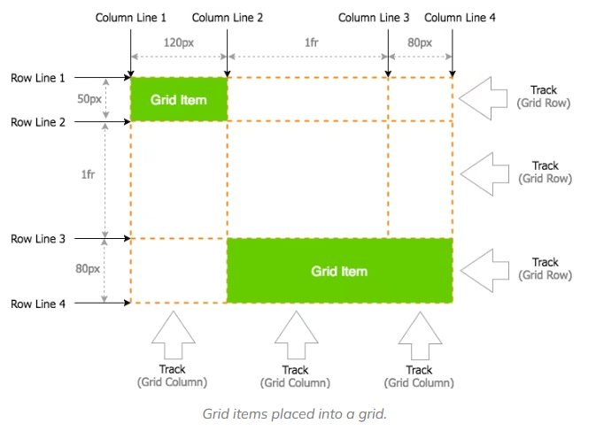
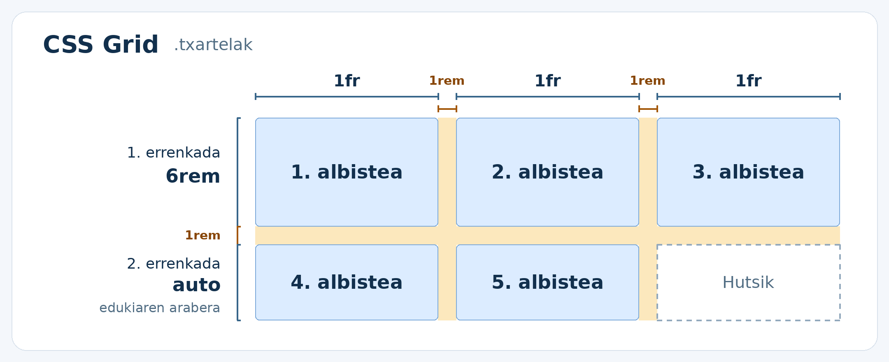
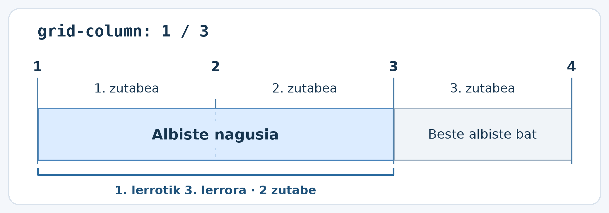
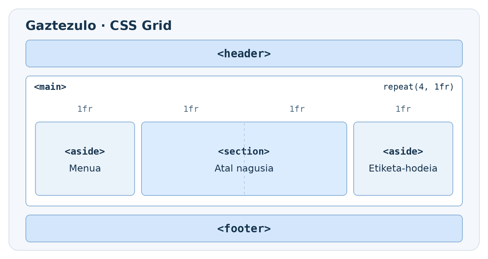
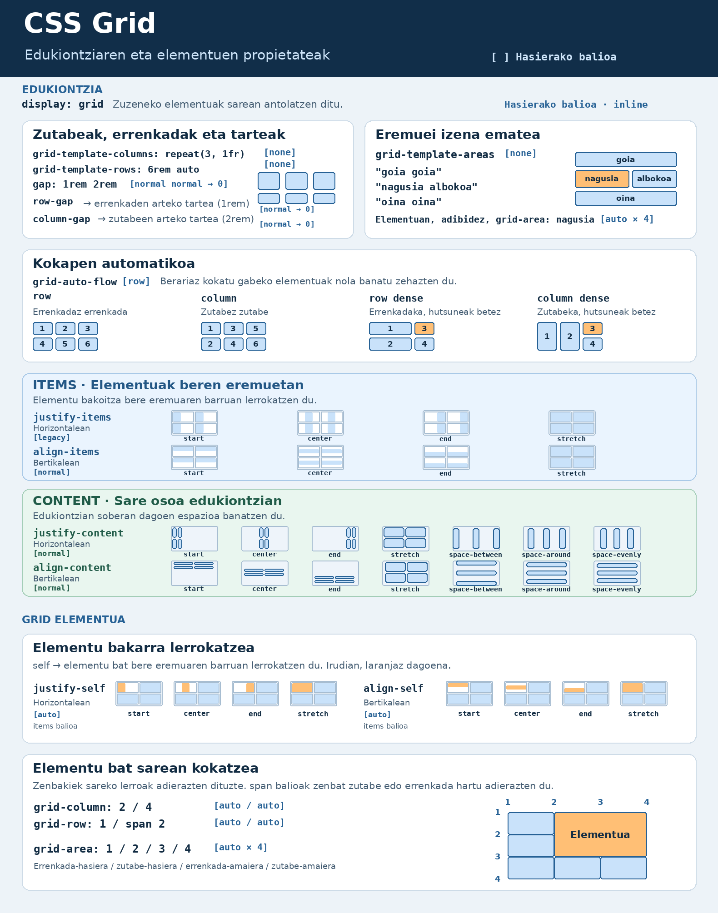

# CSS Grid

CSS Grid elementuak **errenkada eta zutabeetan** antolatzeko erabiltzen da.
Adibidez, albiste-txartelak hiru zutabetan banatzeko edo web-orri bateko
goiburua, eduki nagusia eta alboko atala kokatzeko erabil dezakegu.

!!! tip "Flexbox ala Grid?"

    Erabili **Flexbox** norabide batean antolatzeko, adibidez, menu bateko
    estekak lerro batean jartzeko. Erabili **Grid** errenkadak eta zutabeak
    batera kontrolatu nahi dituzunean, adibidez, txartelak zutabeetan
    lerrokatzeko.

## Grid: oinarrizko kontzeptuak

Grid Layoutekin lanean hastean, xehetasunetan murgildu aurretik ulertu behar dituzun funtsezko hiru termino daude:

- **Grid Container**: Hau da zure diseinuaren edukiontzi nagusia. Behin display aplikatzen duzunean: grid, seme-alaba zuzen guztiak lauki elementu bihurtzen dira, edo grid items.
- **Grid Item**: Gure grid container-aren seme-alaba zuzenak dira, edukiontziak sortutako laukitxoetan jartzen dira.
- **Grid Line**: Gure laukiaren errenkadak eta zutabeak definitzen dituzten lerroak dira.

Oinarrizko kontzeptu horiek CSSren propietateekin konbinatzen dituzunean hasten da magia: grid-template-columns, grid-template-rows, grid-column-start, grid-column-end eta grid-column.



## Grid edukiontzia eta elementuak

`display: grid` **gurasoari** aplikatzen zaio. Gurasoa Grid **edukiontzia**
bihurtzen da, eta haren **zuzeneko umeak** Grid **elementuak** dira.

### Adibidea: txartelak hiru zutabetan

```html
<section class="txartelak">
    <article>1. albistea</article>
    <article>2. albistea</article>
    <article>3. albistea</article>
    <article>4. albistea</article>
    <article>5. albistea</article>
</section>
```

```css
.txartelak {
    display: grid;
    grid-template-columns: repeat(3, 1fr);
    gap: 1rem;
}

.txartelak > article {
    padding: 1rem;
    background-color: #e8f1fa;
}
```

Nabigatzaileak txartelak HTMLko ordenan kokatzen ditu. Lehenengo errenkada
betetzean, bigarrena sortzen du automatikoki.

| 1. zutabea | 2. zutabea | 3. zutabea |
| --- | --- | --- |
| 1. albistea | 2. albistea | 3. albistea |
| 4. albistea | 5. albistea | |

!!! note "Zuzeneko umeak"

    Adibidean, `section` da edukiontzia eta `article` elementuak dira
    sarean kokatzen direnak. `article` baten barruan `h2` bat gehituz gero,
    izenburua txartelaren barruan geratzen da.

## Zutabeak, errenkadak eta tarteak

### Zutabeen zabalera

`grid-template-columns` propietateko balio bakoitzak zutabe bat definitzen
du. `fr` unitateak Grid-en libre geratzen den espazioaren zati bat adierazten
du. Espazio hori banatu aurretik, neurri finkoek eta tarteek hartzen duten
lekua kentzen da.

| Balioa | Emaitza |
| --- | --- |
| `1fr 1fr 1fr` | Hiru zutabe, bakoitzak espazio erabilgarriaren zati bat hartzen du. |
| `repeat(3, 1fr)` | Aurrekoaren forma laburra. |
| `2fr 1fr` | Bi zutabe, lehenengoak bi zati hartzen ditu eta bigarrenak bat. |
| `220px 1fr` | Lehenengo zutabeak 220 px hartzen ditu eta bigarrenak gainerako lekua. |

### Errenkaden altuera

`grid-template-rows` propietateak errenkaden altuera definitzen du.
Utzi altuera zehaztu gabe errenkadak edukiaren arabera haztea nahi baduzu.

```css
.txartelak {
    display: grid;
    grid-template-columns: repeat(3, 1fr);
    grid-template-rows: 6rem auto;
    gap: 1rem;
}
```


Lehenengo errenkadak `6rem`-eko altuera du. Bigarrenaren altuera edukiaren
arabera kalkulatzen da. Txartel gehiago gehituz gero, Grid-ek beste errenkada
batzuk sortuko ditu automatikoki.

### Elementuen arteko tartea

`gap` propietateak errenkaden eta zutabeen **arteko** tartea ezartzen du, aurreko irudian laranjaz ikusten den tartea da.
Edukiontziaren ertzetan ere tartea nahi baduzu, erabili `padding`.

```css
gap: 1rem;         /* Tarte bera bi norabideetan */
gap: 1rem 2rem;    /* Errenkaden artean 1rem, zutabeen artean 2rem */
```

## Albiste nagusiak bi zutabe hartzea

Albisteen atalak hiru zutabe ditu. **Albiste nagusiak lehenengo bi zutabeak**
hartzea nahi dugu, eta beste albistea hirugarrenean agertzea.

```html
<section class="albisteak">
    <article class="nagusia">Albiste nagusia</article>
    <article>Beste albiste bat</article>
</section>
```

```css
.albisteak {
    display: grid;
    grid-template-columns: repeat(3, 1fr);
}

.nagusia {
    grid-column: 1 / 3;
}
```

Zutabeen hasieran eta amaieran **zutabe-lerroak** daude.
Lehenengo zutabea **1. eta 2. lerroen artean** dago, eta bigarrena
**2. eta 3. lerroen artean**.

`grid-column: 1 / 3` idaztean, albiste nagusia **1. lerroan hasten da
eta 3. lerroan amaitzen da**. Tarte horretan bi zutabe daude.



!!! note "Eta errenkadetan?"

    `grid-row` propietateak errenkaden lerroak erabiltzen ditu.
    Adibidez, `grid-row: 1 / 3` idatzita, elementuak lehenengo bi errenkadak hartzen ditu.

## Adibidea: web-orri baten maketazioa

Goiburuak eta orri-oinak zabalera osoa hartzen dute. Erdian, eduki nagusiak
bi zati hartzen ditu eta alboko atalak bat. Pantaila estuetan, atal guztiak
zutabe bakarrean agertzen dira, HTMLko ordenan.

```html
<body>
    <header></header>

    <main class="maketazioa">
        <aside aria-label="Menua"></aside>

        <section class="atal-nagusia" aria-label="Atal nagusia"></section>

        <aside aria-label="Etiketa-hodeia"></aside>
    </main>

    <footer></footer>
</body>
```

```css
header,
footer {
    min-height: 4rem;
    background-color: #d3e6fb;
}

.maketazioa {
    display: grid;
    grid-template-columns: repeat(4, 1fr);
    gap: 1rem;
    margin-block: 1rem;
}

.maketazioa > aside {
    min-height: 12rem;
    background-color: #eaf2fa;
}

.atal-nagusia {
    grid-column: 2 / 4;
    background-color: #dcecff;
}

```



## Grid-en beste propietate batzuk

Gaztezuloren adibidean, `grid-template-columns` erabili dugu zutabeak sortzeko,
eta `grid-column`, atal nagusiak bi zutabe har ditzan. Grid-ek elementuak
lerrokatzeko eta sarearen barruko espazioa banatzeko propietateak ere baditu.

Irudia irakurtzeko, begiratu **zer mugitzen den**:

- **Elementu guztiak, bakoitza bere eremuaren barruan** → `justify-items`
  horizontalean lerrokatzeko eta `align-items` bertikalean lerrokatzeko.
- **Elementu bakarra, bere eremuaren barruan** → `justify-self`
  horizontalean lerrokatzeko eta `align-self` bertikalean lerrokatzeko.
- **Sare osoa, edukiontziaren barruan** → `justify-content` soberako espazio
  horizontala banatzeko eta `align-content` soberako espazio bertikala banatzeko.



