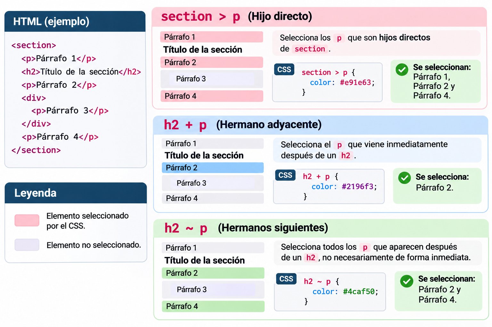
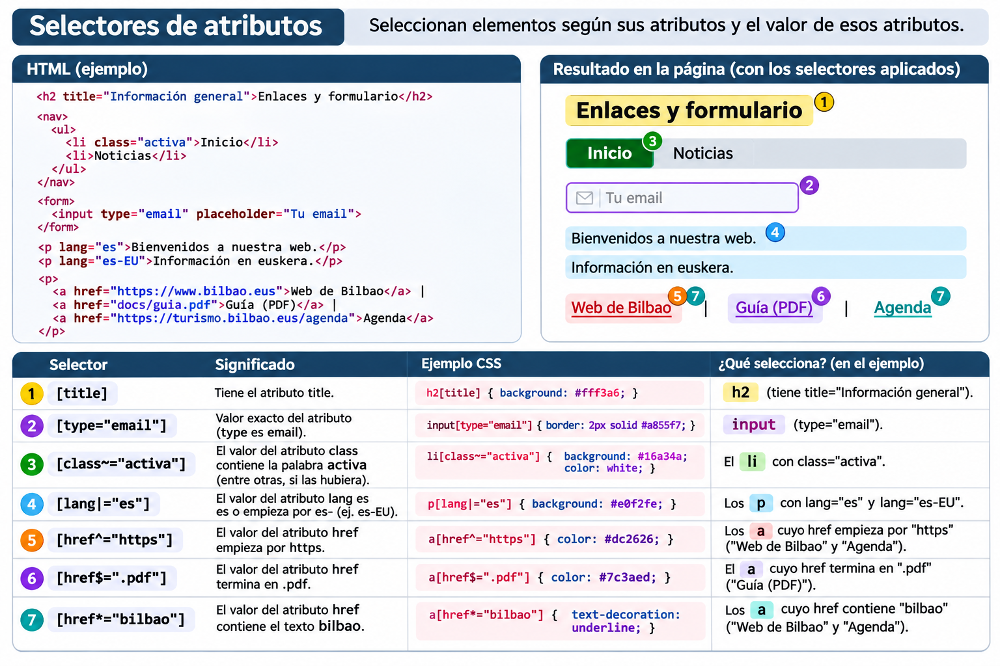

# CSS hautatzaileak, kaskada eta herentzia

CSS erabiliz, HTML elementuen itxura alda dezakegu. Horretarako, lehenengo **zein elementuri** aplikatu nahi diegun estiloa adierazi behar dugu: horixe da **hautatzailearen** lana.

!!! info "Ikasi eta praktikatu"
    Azalpen bakoitzean HTMLa, CSSa eta espero den emaitza aurkituko dituzu. Ondoren, erabili [CSS hautatzaileen laborategia (54 ariketa)](https://css-hautatzaileen-laborategia.jone-m.chatgpt.site) ikasitakoa praktikatzeko.

## 1. CSS arau baten egitura

```css
h1 {
    color: darkblue;
    font-size: 2rem;
}
```

- `h1`: **hautatzailea**; zein elementu hautatu
- `color` eta `font-size`: **propietateak**; zer aldatu
- `darkblue` eta `2rem`: **balioak**; nola aldatu
- `propietatea: balioa;`: **adierazpena**; giltzen artean adierazpen bat baino gehiago egon daiteke

!!! tip "Gogoratu"
    Hautatzaileak **nori** aplikatuko zaion esaten du; adierazpenek, berriz, **zer estilo** aplikatuko den.

## 2. Oinarrizko hautatzaileak

| Hautatzailea | Adibidea | Zer hautatzen du? |
|---|---|---|
| Elementua | `p` | `p` elementu guztiak |
| Klasea | `.oharra` | `class="oharra"` duten elementuak |
| IDa | `#nagusia` | `id="nagusia"` duen elementua |
| Unibertsala | `*` | Elementu guztiak |
| Multzokatzea | `h1, h2, p` | Hiru hautatzaileetako edozeinekin bat datozenak |

### 2.1. Elementuak eta klaseak

=== "HTML"
    ```html
    <h2>Albisteak</h2>
    <p>Lehenengo albistea</p>
    <p class="nabarmena">Albiste garrantzitsua</p>
    <p>Beste albiste bat</p>
    ```

=== "CSS"
    ```css
    p { color: #333; }
    .nabarmena {
        color: #a10043;
        font-weight: bold;
    }
    ```

=== "Emaitza"
    <div style="border:1px solid #ddd;padding:1rem;border-radius:8px">
      <h3 style="margin-top:0">Albisteak</h3>
      <p style="color:#333">Lehenengo albistea</p>
      <p style="color:#a10043;font-weight:bold">Albiste garrantzitsua</p>
      <p style="color:#333">Beste albiste bat</p>
    </div>

**Zergatik?** `p` hautatzaileak hiru paragrafoak hautatzen ditu; `.nabarmena` hautatzaileak, berriz, klase hori duen bakarra. Azken horretan `color` propietatea zehatzagoa den arauak ezartzen du.

### 2.2. Klasea eta elementu mota batera

```css
.nabarmena { color: red; }    /* Klase hori duen edozein elementu */
p.nabarmena { color: blue; }  /* Klase hori duten p elementuak soilik */
```

Klase bera hainbat elementutan erabil daiteke. IDak, aldiz, **bakarra izan behar du HTML dokumentu berean**. CSS estilo orokorrak aplikatzeko, normalean **klaseak lehenestea** komeni da, berrerabilgarriagoak direlako.

### 2.3. Hautatzaile unibertsala

```css
*{
    box-sizing: border-box;
}
```

Horrela, elementuen zabalera eta altuera kalkulatzean `padding` eta `border` kontuan hartzen dira. Ohikoa da proiektuetan. Aldiz, `* { margin: 0; padding: 0; border: 0; }` bezalako reset orokorrak kontuz erabili: nabigatzailearen estilo erabilgarriak ere kentzen dituzte.

## 3. Erlazio-hautatzaileak

Hautatzaile hauek HTMLko **egituran** oinarritzen dira.

| Idazkera | Izena | Zer hautatzen du? |
|---|---|---|
| `section p` | Ondorengoa | `section` baten barruko `p` guztiak, edozein sakoneratan |
| `section > p` | Seme zuzena | `section` elementuaren seme zuzen diren `p` elementuak |
| `h2 + p` | Ondoko anaia | `h2` baten ondoren **berehala** datorren `p` anaia |
| `h2 ~ p` | Ondorengo anaiak | `h2` baten ondoren datozen `p` anaiak, ez derrigor jarraian |



### 3.1. Ondorengoa (` `) eta seme zuzena (`>`) alderatzea

=== "HTML"
    ```html
    <section>
        <p>A: zuzeneko semea</p>
        <div>
            <p>B: barruko ondorengoa</p>
        </div>
        <p>C: zuzeneko semea</p>
    </section>
    ```

=== "CSS: bi aukera"
    ```css
    section p { color: blue; }   /* A, B eta C */
    section > p { color: red; } /* A eta C */
    ```

=== "Emaitza"
    <div style="border:2px solid #aaa;padding:12px;border-radius:8px">
      <small>section</small>
      <p style="color:#b42318;font-weight:600">A: zuzeneko semea — gorria</p>
      <div style="border:1px dashed #aaa;padding:10px;margin:8px 0"><small>div</small><p style="color:#1456b8">B: barruko ondorengoa — urdina</p></div>
      <p style="color:#b42318;font-weight:600">C: zuzeneko semea — gorria</p>
    </div>

!!! note "Kontuz emaitzarekin"
    Bi CSS arauak **batera** aplikatzen badira, A eta C gorriak izango dira, `section > p` araua geroago idatzita dagoelako eta bi hautatzaileek espezifikotasun bera dutelako. B urdina izango da.

### 3.2. Ondoko anaia (`+`) eta ondorengo anaiak (`~`)

=== "HTML"
    ```html
    <h2>Egitaraua</h2>
    <p>Lehenengo paragrafoa</p>
    <div>Informazio gehigarria</div>
    <p>Bigarren paragrafoa</p>
    ```

=== "CSS"
    ```css
    h2 + p { color: red; }  /* Lehenengo p bakarrik */
    h2 ~ p { font-weight: bold; } /* Bi p elementuak */
    ```

=== "Emaitza"
    <div style="border:1px solid #ddd;padding:12px;border-radius:8px">
      <strong>Egitaraua</strong>
      <p style="color:#b42318;font-weight:bold">Lehenengo paragrafoa (gorria eta lodia)</p>
      <div>Informazio gehigarria</div>
      <p style="font-weight:bold">Bigarren paragrafoa (lodia)</p>
    </div>

Bi elementuek **guraso bera** izan behar dute anaiak izateko. `+` hautatzaileak berehalako ondoko anaia hautatzen du; `~` hautatzaileak, berriz, ondoren datozen anaia guztiak, hautatzailearekin bat badatoz.

## 4. Atributu-hautatzaileak

HTML elementuen atributuak eta balioak aztertzen dituzte.

| Hautatzailea | Esanahia | Adibidea |
|---|---|---|
| `[title]` | `title` atributua dauka | `[title]` |
| `[type="email"]` | Balio zehatza | `input[type="email"]` |
| `[class~="aktiboa"]` | Hitz bereizi bat | `[class~="aktiboa"]` |
| `[lang|="eu"]` | `eu` edo `eu-` hasiera | `[lang|="eu"]` |
| `[href^="https"]` | Balioa horrekin hasten da | `a[href^="https"]` |
| `[href$=".pdf"]` | Balioa horrekin amaitzen da | `a[href$=".pdf"]` |
| `[href*="bilbao"]` | Balioak testu hori dauka | `a[href*="bilbao"]` |




### Adibide erabilgarria: PDF estekak bereiztea

=== "HTML"
    ```html
    <a href="egitaraua.pdf">Egitaraua (PDF)</a>
    <a href="kontaktua.html">Kontaktua</a>
    ```

=== "CSS"
    ```css
    a[href$=".pdf"] {
        color: #b42318;
        font-weight: bold;
    }
    ```

=== "Emaitza"
    <div style="padding:12px;border:1px solid #ddd;border-radius:8px;display:flex;gap:18px;flex-wrap:wrap">
      <span style="color:#b42318;font-weight:bold;text-decoration:underline">Egitaraua (PDF)</span>
      <span style="color:#1456b8;text-decoration:underline">Kontaktua</span>
    </div>

!!! warning "Xehetasun garrantzitsua"
    `[href$=".pdf"]` hautatzaileak **ez du** `.pdf?download=1` amaiera duen URL bat hautatzen. Hautatzaileak atributuaren testua aztertzen du, ez fitxategiaren benetako mota.

## 5. Pseudoklaseak (`:`)

Pseudoklaseek elementuaren **egoera** edo **kokapena** adierazten dute.

### 5.1. Erabiltzailearen interakzioa

| Pseudoklasea | Noiz aplikatzen da? |
|---|---|
| `:hover` | Sagua elementuaren gainean dagoenean |
| `:focus` | Elementuak fokua duenean |
| `:focus-visible` | Nabigatzaileak fokuaren adierazlea erakustea egokitzat jotzen duenean |
| `:active` | Elementua aktibatzen ari denean (adibidez, klik egitean) |
| `:checked` | Checkbox edo radio hautatuta dagoenean |
| `:disabled` | Formulario-kontrola desgaituta dagoenean |

```css
nav a:hover { color: #b42318; }
nav a:focus-visible {
    outline: 3px solid #f0b429;
    outline-offset: 3px;
}
```

!!! tip "Irisgarritasuna"
    Ez kendu fokuaren adierazlea `outline: none` erabiliz ordezko ikusgarririk jarri gabe. Teklatuarekin nabigatzen duten erabiltzaileek fokua non dagoen ikusi behar dute. `:hover` bakarrik ez da nahikoa.

### 5.2. Elementuen kokapena

| Pseudoklasea | Zer hautatzen du? |
|---|---|
| `:first-child` | Gurasoaren lehenengo elementu-semea |
| `:last-child` | Gurasoaren azken elementu-semea |
| `:only-child` | Gurasoaren elementu-seme bakarra |
| `:nth-child(2)` | Gurasoaren bigarren elementu-semea |
| `:nth-child(odd)` | Posizio bakoitietan dauden semeak |
| `:nth-child(even)` | Posizio bikoitietan dauden semeak |
| `:nth-of-type(2)` | Mota bereko bigarren elementua, anaien artean |

=== "HTML"
    ```html
    <ul>
        <li>Lehenengoa</li>
        <li>Bigarrena</li>
        <li>Hirugarrena</li>
        <li>Laugarrena</li>
    </ul>
    ```

=== "CSS"
    ```css
    li:nth-child(2) { background: lightgreen; }
    li:nth-child(even) { font-weight: bold; }
    ```

=== "Emaitza"
    <div style="border:1px solid #ddd;padding:12px;border-radius:8px">
      <div style="padding:6px">• Lehenengoa</div>
      <div style="padding:6px;background:#c8edc6;color:#164b23;font-weight:bold">• Bigarrena</div>
      <div style="padding:6px">• Hirugarrena</div>
      <div style="padding:6px;font-weight:bold">• Laugarrena</div>
    </div>

!!! warning "`nth-child` eta `nth-of-type` ez dira gauza bera"
    ```html
    <div>
        <h2>Izenburua</h2>
        <p>Lehen paragrafoa</p>
        <p>Bigarren paragrafoa</p>
    </div>
    ```
    - `p:nth-child(2)` → **lehen paragrafoa** (`div`-aren bigarren semea)
    - `p:nth-of-type(2)` → **bigarren paragrafoa** (bigarren `p` elementua)

### 5.3. Ezeztapena: `:not()`

```css
/* .berezia klaserik ez duten li elementuak */
li:not(.berezia) { color: #555; }
```

`:not()` erabilgarria da salbuespenak adierazteko. Hala ere, arau oso zabalak, hala nola `:not(p)`, kontuz erabili: espero ez dituzun elementu askori eragin diezaiekete.

## 6. Pseudoelementuak (`::`)

Pseudoelementuek elementu baten **zati bat** edo **sortutako edukia** hautatzen dute.

| Pseudoelementua | Erabilera |
|---|---|
| `::first-letter` | Testu-bloke baten lehenengo letra |
| `::first-line` | Testu-bloke baten lehenengo lerroa (zabaleraren arabera alda daiteke) |
| `::before` | Elementuaren edukiaren hasieran sortutako edukia |
| `::after` | Elementuaren edukiaren amaieran sortutako edukia |
| `::selection` | Erabiltzaileak hautatutako testua |
| `::placeholder` | Formulario-eremu baten adibide-testua |

=== "HTML"
    ```html
    <p class="oharra">Kontuz: azken eguna ostirala da.</p>
    ```

=== "CSS"
    ```css
    .oharra::before {
        content: "⚠ ";
        color: darkorange;
    }
    .oharra::first-letter {
        font-weight: bold;
    }
    ```

=== "Emaitza"
    <div style="padding:12px;border:1px solid #ddd;border-radius:8px"><span style="color:#b66a00">⚠ </span><strong>K</strong>ontuz: azken eguna ostirala da.</div>

!!! note "Edukia eta aurkezpena"
    `::before` eta `::after` elementuek `content` propietatea behar dute sortutako edukia agertzeko. Ez erabili CSS bidez sortutako edukia informazio funtsezko bakarra emateko; informazio garrantzitsua HTMLan bertan egon dadila.

## 7. Kaskada: bi arauk elementu bera aldatzen dutenean

CSSk hainbat arau konbinatzen ditu. Propietate berean gatazka dagoenean, **kaskadak** erabakitzen du zein balio aplikatu.

Ikasleentzat, lehenengo honako galdera hauek egitea komeni da:

1. Bi arauak elementu berari aplikatzen al zaizkio?
2. Biek propietate bera aldatzen al dute?
3. Zein da arauen jatorria, garrantzia eta kaskada-geruza?
4. Geruza eta garrantzi bereko arauak badira, zeinek du **espezifikotasun handiagoa**?
5. Espezifikotasuna berdina bada, **zein dator geroago**?

### 7.1. Espezifikotasuna: eredua

| Hautatzailea | ID | Klase / atributu / pseudoklase | Elementu / pseudoelementu |
|---|---:|---:|---:|
| `p` | 0 | 0 | 1 |
| `.oharra` | 0 | 1 | 0 |
| `p.oharra` | 0 | 1 | 1 |
| `#nagusia` | 1 | 0 | 0 |
| `#nagusia p.oharra` | 1 | 1 | 1 |

Espezifikotasuna **zutabez zutabe, ezkerretik eskuinera** alderatzen da: ID bat edozein klase-kopuru baino lehenago doa. Ez da hamartarren batura bat. Inline estiloek (`style="..."`) berezko lehentasun handiagoa dute estilo-orrietako hautatzaile arruntek baino; `!important`, geruzek eta jatorriek emaitza alda dezakete.

=== "HTML"
    ```html
    <p id="mezua" class="oharra">Kaixo!</p>
    ```

=== "CSS"
    ```css
    p { color: black; }
    .oharra { color: blue; }
    #mezua { color: red; }
    ```

=== "Emaitza"
    <div style="border:1px solid #ddd;padding:12px;border-radius:8px"><span style="color:#b42318;font-weight:bold">Kaixo! (gorria)</span></div>

**Zergatik?** Hiru arauek paragrafoa hautatzen dute, baina `#mezua` hautatzaileak espezifikotasun handiagoa du.

### 7.2. Espezifikotasun bera: ordena

```css
.oharra { color: blue; }
.oharra { color: green; } /* Honek irabazten du */
```

Bi arauak jatorri, garrantzi, geruza eta espezifikotasun berekoak direnez, **azkena** aplikatzen da.

### 7.3. `!important`: kontuz

```css
.oharra { color: red !important; }
```

`!important` ez da ohiko konponbidea: kaskadaren garrantzi-ordena aldatzen du, eta ondorengo aldaketak zaildu ditzake. Lehenengo, egiaztatu hautatzaileak, espezifikotasuna eta arauen ordena.

!!! info "Aurrerago: `@layer`"
    CSS modernoan, `@layer` erabil daiteke estiloak geruzatan antolatzeko. Geruzen ordenak espezifikotasuna baino lehenago eragin dezake kaskadan. Lehen mailan nahikoa da jakitea **espezifikotasuna ez dela gatazka guztien erantzun bakarra**.

## 8. Herentzia: zer jasotzen dute semeek?

HTML elementu batzuek gurasoaren CSS propietateen balioak **heredatzen** dituzte.

=== "HTML"
    ```html
    <div class="kutxa">
        <h2>Izenburua</h2>
        <p>Paragrafoa</p>
    </div>
    ```

=== "CSS"
    ```css
    .kutxa {
        color: darkgreen;
        font-family: Arial, sans-serif;
        border: 2px solid green;
    }
    ```

=== "Emaitza"
    <div style="border:2px solid green;padding:12px;border-radius:6px;color:darkgreen;font-family:Arial,sans-serif"><h3 style="color:inherit;margin-top:0">Izenburua</h3><p style="color:inherit">Paragrafoa</p></div>

`color` eta `font-family` normalean heredatzen dira; `border`, `margin`, `padding`, `width` eta `background-color`, normalean, **ez**. Horregatik, adibidean semeen testua berdea da, baina ez dute bakoitzak bere ertz berdea.

| Balioa | Zer egiten du? |
|---|---|
| `inherit` | Gurasoaren kalkulatutako balioa erabiltzen du |
| `initial` | Propietatearen hasierako CSS balioa erabiltzen du |
| `unset` | Heredagarria bada, `inherit`; bestela, `initial` |
| `revert` | Uneko jatorriaren eragina atzera botatzen du, kaskadaren arabera |

```css
.kutxa p { color: inherit; }
```

!!! warning "Herentzia ez da hautatzailea"
    `.kutxa p` arauak paragrafoa zuzenean hautatzen du. Aldiz, `.kutxa { color: green; }` arauak kutxa hautatzen du, eta paragrafoak kolorea **herentziaz** jaso dezake. Bi mekanismo desberdin dira.

## 9. CSS hautatzaile modernoak (osagarria)

### 9.1. `:is()` — aukerak multzokatzea

```css
:is(header, footer) a {
    color: white;
}
```

`header` edo `footer` barruan dauden estekak hautatzen ditu. Espezifikotasunean, `:is()` barruko hautatzaile **espezifikoenak** eragiten du.

### 9.2. `:where()` — espezifikotasunik gehitu gabe

```css
:where(header, footer) a {
    text-decoration: none;
}
```

Antzeko multzokatzea egiten du, baina `:where()`-k **0 espezifikotasuna** du bere barruko hautatzaileak edozein direla ere. Horregatik, oinarrizko estilo erraz gainidaztekoetan erabilgarria da.

### 9.3. `:has()` — barruko elementuen arabera hautatzea

=== "HTML"
    ```html
    <article class="txartela">
        <h2>Kontzertua</h2>
        
    </article>
    <article class="txartela">
        <h2>Oharra</h2>
        <p>Ez dago irudirik</p>
    </article>
    ```

=== "CSS"
    ```css
    .txartela:has(img) {
        border: 2px solid purple;
    }
    ```

=== "Emaitza"
    <div style="display:flex;gap:12px;flex-wrap:wrap">
      <div style="border:2px solid purple;padding:12px;border-radius:6px;flex:1;min-width:130px"><strong>Kontzertua</strong><div style="background:#e9dafa;color:#4c2670;padding:15px;margin-top:8px;text-align:center">▧ Irudia</div></div>
      <div style="border:1px solid #bbb;padding:12px;border-radius:6px;flex:1;min-width:130px"><strong>Oharra</strong><p>Ez dago irudirik</p></div>
    </div>

**Zergatik?** Lehenengo `article` elementuak `img` dauka barruan; bigarrenak ez. `:has()` hautatzaileak **article** bera hautatzen du, ez irudia.

!!! note "Maila honetan"
    `:is()`, `:where()` eta `:has()` ezagutzea komeni da, baina oinarrizko hautatzaileak eta kaskada menperatzea lehenetsiko dugu.

## 10. Ohiko akatsak eta gomendioak

| Akatsa | Nola zuzendu |
|---|---|
| `p:nth-child(2)` bigarren `p` dela pentsatzea | Gurasoaren **bigarren semea** izan behar du; alderatu `:nth-of-type(2)`-rekin |
| `section p` eta `section > p` nahastea | Lehenak ondorengo guztiak; bigarrenak seme zuzenak |
| IDak estilo guztietarako erabiltzea | Estilo berrerabilgarrietarako, normalean, klaseak erabili |
| `!important` etengabe erabiltzea | Hautatzaileak, espezifikotasuna eta kaskada aztertu |
| `:hover`-ekin bakarrik diseinatzea | `:focus-visible` ere kontuan hartu |
| `* { margin:0; padding:0; border:0 }` automatikoki erabiltzea | Resetaren ondorioak ulertu eta behar dena bakarrik aldatu |
| CSSko eduki sortua informazio bakar gisa erabiltzea | Eduki garrantzitsua HTMLan idatzi |

## 11. Laburpena

- **Hautatzaileek** elementuak aukeratzen dituzte
- **Erlazio-hautatzaileek** HTMLko egitura erabiltzen dute
- **Pseudoklaseek** egoerak eta posizioak adierazten dituzte
- **Pseudoelementuek** elementu baten zatiak edo sortutako edukia hautatzen dute
- **Kaskadak eta espezifikotasunak** gatazkak ebazten laguntzen dute
- **Herentziak** gurasotik semera propietate batzuen balioak transmititzen ditu

### Praktikatzeko

[**Ireki CSS hautatzaileen laborategia — 54 ariketa**](https://css-hautatzaileen-laborategia.jone-m.chatgpt.site){ .md-button .md-button--primary }

Laborategiko ariketak egin aurretik, saiatu erantzuna **zergatik** den zuzena azaltzen. Hautatzaile batek funtzionatzea ez da nahikoa: zer elementu hautatzen duen ulertzea da helburua.

### Erreferentzia gehiago

- [MDN — CSS selectors](https://developer.mozilla.org/en-US/docs/Web/CSS/CSS_selectors)
- [MDN — Cascade](https://developer.mozilla.org/en-US/docs/Web/CSS/CSS_cascade/Cascade)
- [MDN — Inheritance](https://developer.mozilla.org/en-US/docs/Web/CSS/CSS_cascade/Inheritance)
- [W3Schools — CSS selectors](https://www.w3schools.com/css/css_selectors.asp)
