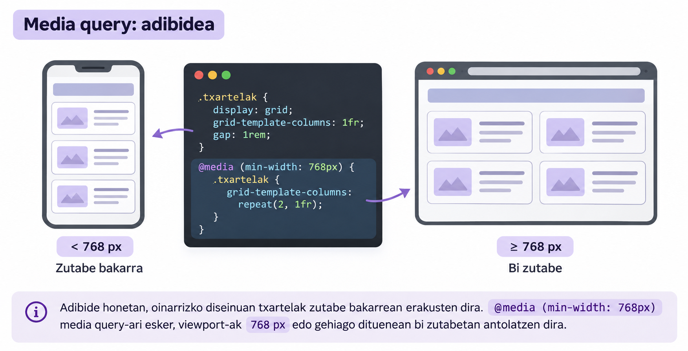

## Diseinu moldagarria (Responsive Design)

Diseinu moldagarria edo *Responsive Web Design* webgune baten itxura eta edukien antolaketa pantailaren tamainara egokitzea da. Horrela, webgunea mugikorretan, tabletetan eta ordenagailuetan eroso erabili ahal izango da.

Diseinu moldagarria lortzeko, hainbat teknika erabil ditzakegu:

- **Unitate erlatiboak:** elementuen tamainak modu malguan definitzeko.
- **Irudi moldagarriak:** irudiak edukiontzitik kanpo ez ateratzeko.
- **Flexbox eta Grid:** elementuak espazio erabilgarriaren arabera antolatzeko.
- **Media queries:** pantailaren zabaleraren arabera estiloak aldatzeko.

!!! tip "Ideia nagusia"
    Diseinu moldagarria ez da webgunearen amaieran gehitzen den zerbait. Hasieratik kontuan hartu behar dugu webgunea tamaina desberdinetako pantailetan erabiliko dela.

### Viewport

*Viewport* nabigatzailean web-orria ikusteko erabilgarri dagoen eremua da.

Mugikorretan webgunea pantailaren zabalerara behar bezala egokitzeko, HTML dokumentuaren `<head>` atalean honako etiketa gehitzen dugu:

```html
<meta name="viewport" content="width=device-width, initial-scale=1.0">
```

- `width=device-width`: viewport-aren zabalera gailuaren zabalerara egokitzen du.
- `initial-scale=1.0`: orria hasierako eskalan erakusten du, zoom gehigarririk gabe.

!!! note "Kontuan izan"
    Etiketa honek ez du berez diseinua moldagarri bihurtzen: CSS ere egokitu behar dugu.

### Unitate erlatiboak

CSSn `px` bezalako unitate finkoak erabil ditzakegu, baina diseinu moldagarrietan unitate erlatiboak ere oso erabilgarriak dira. Unitate horiek erreferentzia baten arabera kalkulatzen dira.

| Unitatea | Esanahia | Adibidea |
|---|---|---|
| `%` | Erreferentziazko neurri baten ehunekoa; `width` propietatean, normalean edukiontziaren zabalerarena | `width: 80%` |
| `rem` | Erro-elementuaren (`html`) letra-tamainaren araberakoa | `font-size: 1.5rem` |
| `em` | Letra-tamainaren araberakoa; `padding`-en elementuaren beraren letra-tamaina hartzen du erreferentziatzat | `padding: 2em` |
| `vw` | Viewport-aren zabaleraren % 1 | `width: 50vw` |
| `vh` | Viewport-aren altueraren % 1 | `height: 50vh` |

#### Adibidea

```css
main {
    width: 80%;
    max-width: 1200px;
    margin: auto;
    padding: 1rem;
}

h1 {
    font-size: 2rem;
}
```

- `width: 80%`: `main` elementuak bere edukiontziaren zabaleraren % 80 hartuko du.
- `max-width: 1200px`: ez da 1200 px baino zabalagoa izango.
- `margin: auto`: elementua horizontalki erdiratzen laguntzen du.
- `padding: 1rem`: barne-tartea erro-elementuaren letra-tamainaren arabera kalkulatzen da.

!!! note "Kontuan izan"
    `width: 80%` eta `max-width: 1200px` batera erabiltzea ohikoa da: edukia pantaila txikietan egokitzen da eta pantaila handietan ez da gehiegi zabaltzen. `em` eta `rem` ez dira berdinak: `rem`-ek erro-elementua hartzen du erreferentziatzat; `em`-en erreferentzia propietatearen araberakoa da.

### Irudi moldagarriak

Irudi bat bere edukiontzia baino zabalagoa bada, pantailatik kanpo atera daiteke. Hori saihesteko:

```css
img {
    max-width: 100%;
    height: auto;
}
```

- `max-width: 100%`: irudiak ez du bere edukiontziaren zabalera gaindituko.
- `height: auto`: irudiaren proportzioak mantentzen ditu.

Horrela, irudi handiak txikitu egingo dira beharrezkoa denean, baina ez dira derrigorrez edukiontziaren zabalera osora handituko.

### Media queries

*Media query* batek CSS arauak baldintza baten arabera aplikatzeko aukera ematen du. Diseinu moldagarrian, normalean viewport-aren zabaleraren arabera erabiltzen dugu.

#### Sintaxia

```css
@media (min-width: 768px) {
    /* Viewport-ak gutxienez 768 px dituenean */
}
```

`min-width: 768px` baldintzak esan nahi du barruko estiloak **768 px-ko zabaleratik aurrera** aplikatuko direla.


#### Breakpoints edo eten-puntuak

*Breakpoint* bat diseinua aldatzeko aukeratzen dugun pantaila-zabalera da. Adibidez, `768px` erabil dezakegu elementuak elkarren ondoan jartzeko nahikoa espazio dagoenean.

!!! tip "Nola aukeratu breakpoint bat?"
    Ez dago mugikor, tablet eta ordenagailu guztietarako balio duen neurri bakarra. Edukia ondo antolatzeko espaziorik ez dagoenean aukeratuko dugu eten-puntua.

#### Mobile First

*Mobile First* ikuspegian, lehenengo pantaila txikietarako estiloak idazten dira eta, ondoren, pantaila handiagoetarako egokitzapenak gehitzen dira. Horretarako, `min-width` erabiltzen dugu.

```css
/* Pantaila txikiak: oinarrizko diseinua */
.txartelak {
    display: grid;
    grid-template-columns: 1fr;
    gap: 1rem;
}

/* Pantaila zabalagoak */
@media (min-width: 768px) {
    .txartelak {
        grid-template-columns: repeat(2, 1fr);
    }
}
```

- **768 px baino gutxiago:** txartelak zutabe bakarrean agertzen dira.
- **768 px-tik aurrera:** bi zutabetan antolatzen dira.



!!! note "CSS arauen ordena"
    Lehenengo estilo orokorrak idazten ditugu eta, ondoren, media query-ak. Baldintza betetzen denean, media query-ko arauek aurreko balioak ordezka ditzakete, kaskadaren eta espezifikotasunaren arabera.

### Flexbox eta Grid diseinu moldagarrian

Media query-ak erabilgarriak dira, baina batzuetan Flexbox eta Grid-en propietateekin bakarrik ere lor dezakegu diseinu moldagarria.

#### Flexbox: `flex-wrap`

```css
.txartelak {
    display: flex;
    flex-wrap: wrap;
    gap: 1rem;
}

.txartela {
    flex: 1 1 250px;
}
```

- `display: flex`: txartelak Flexbox bidez antolatzen ditu.
- `flex-wrap: wrap`: tokirik ez dagoenean, elementuak hurrengo lerrora pasatzen dira.
- `flex: 1 1 250px`: txartelak 250 px inguruko oinarrizko zabaleratik abiatzen dira, eta espazioaren arabera hazi edo txikitu daitezke.

#### Grid: `auto-fit` eta `minmax()`

```css
.txartelak {
    display: grid;
    grid-template-columns: repeat(auto-fit, minmax(250px, 1fr));
    gap: 1rem;
}
```

- `repeat()`: zutabeen eredua errepikatzen du.
- `auto-fit`: erabilgarri dagoen espazioan sartzen diren zutabeak sortzen ditu eta zutabeak espazioa betetzeko egokitzen ditu.
- `minmax(250px, 1fr)`: zutabe bakoitzaren gutxieneko zabalera 250 px da; espazio gehiago badago, zabaldu egin daiteke.

Horrela, nabigatzaileak automatikoki egokitzen du zutabe kopurua, media query-rik idatzi gabe.

!!! note "Kontuan izan"
    Grid-en adibide honetan, edukiontzia 250 px baino estuagoa bada, edukia gainezka atera daiteke. Horregatik, diseinua zabalera txikietan ere probatu behar dugu.

!!! tip "Zein teknika erabili?"
    Elementuak automatikoki beste lerro edo zutabe batzuetara pasatzea nahi badugu, `flex-wrap` edo `auto-fit` erabil ditzakegu. Pantailaren zabalera jakin batetik aurrera diseinuaren egitura edo estiloak aldatu nahi baditugu, media query bat erabil dezakegu. Teknikak batera ere erabil daitezke.

### Diseinu moldagarria probatzea

Webgune bat moldagarria dela egiaztatzeko, nabigatzailearen garatzaile-tresnak erabil ditzakegu:

1. Ireki webgunea nabigatzailean.
2. Sakatu `F12` garatzaile-tresnak irekitzeko.
3. Aktibatu gailuen ikuspegia (*Device Toolbar* edo *Responsive Design Mode*).
4. Aldatu viewport-aren zabalera, pixkanaka.
5. Egiaztatu elementuak ondo egokitzen direla.

Begiratu bereziki ea edukia pantailatik kanpo ateratzen den, desplazamendu horizontala agertzen den, testuak irakurgarriak diren eta irudiak deformatzen diren.

!!! tip "Gogoratu"
    Webgune moldagarri batek ez du soilik mugikorrean eta ordenagailuan ondo ikusi behar: tarteko zabaleretan ere erabilgarria izan behar du.
